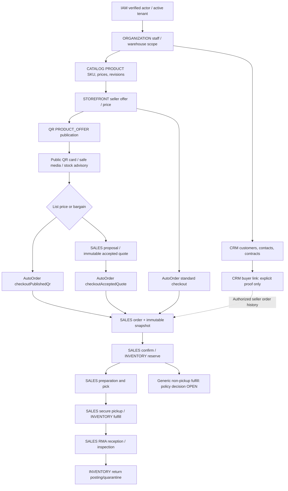

# RM-DUAL-PRODUCT-FOUNDATION-R1 — единая сервисная основа RM Business и RM QR Commerce

**Дата:** 2026-11-23. **Ветка:** `base_dev`. **Source baseline:** `7409f26a1ca4b62cf4406d3110e6764699aeb491`.  
**Решение:** ACTIVE PRODUCT FOUNDATION / SERVICE-FIRST / IMPLEMENTATION THROUGH EXISTING DOMAIN SERVICES.  
**Граница:** продуктовые контракты, capability registry и план доказательной приёмки; документ **не утверждает** создание новых работающих сервисов, миграций, тестов или production admission.  
**Controllers, UI, real OIDC and production:** HOLD/STOP. `main` без изменений.

## 1. Для чего создаётся foundation

RM должен решать **две коммерческие задачи одной системой**:

1. **RM Business (основной продукт):** сотрудник SMB создаёт/ведёт клиента, товары и цены, видит склад, принимает заказ, резервирует и исполняет его, сохраняя историю.
2. **RM QR Commerce (торговый канал и дифференциация):** продавец публикует реальный товар в витрине, выдаёт постоянный QR, покупатель видит карточку, покупает или торгуется, продавец подтверждает, склад готовит и безопасно выдаёт, покупатель может оформить и физически вернуть товар.

**Не строить** две базы данных, две модели Order, два inventory ledger, два IAM, новый `DomainModule.PRODUCT` или новый generic `BusinessWorkflowEngine`. Названия Business и QR являются **продуктовыми профилями/маршрутами**, а не дополнительными bounded contexts. Один tenant может иметь несколько складов в рамках SME; позиционирование RM Network как самостоятельного рынка прекращено, tenant/isolation/location capabilities сохраняются.

**Нормативная иерархия:** `docs/architecture/RM-PLATFORM-STANDARD-R2.md` > одобренные доменные контрактные решения > `docs/spec/RM-CORE-FUNCTIONAL-CLOSURE-R1.md` (R1.2) > этот product-composition план. Продуктовая стратегия: `docs/strategy/RM-PRODUCT-STRATEGY-R2-SMB-QR.md`. Аудит: `docs/reviews/RM-DEEP-TECH-AUDIT-R1-2026-11-23.md`. При разночтениях — формальное DECISION REQUIRED, а не правка security policy молча.

## 2. Карта двух продуктов и общий архитектурный путь

`SALES` owns order aggregate, status, quote, packaging service line, physical handover and returns. `INVENTORY` owns stock/reservation/movement, and is only mutated through existing trusted owner ports. `CRM` owns customer and consent but **not** SALES order status. `CATALOG` owns SKU and catalogue revision, `STOREFRONT` owns current sellable offer price. `IAM` owns global buyer/staff identity, workspace/membership/grants. `FILES` owns safe public media. Immutable events and sanitized audit supplement, not replace, authoritative business data.

## 3. RM Business foundation — what a small company actually needs

### 3.1 Five roles and trust scopes

| Persona | User need | Access admission (actual existing model; not automatic role grant) | Negative case |
|---|---|---|---|
| Business owner | create first workspace, hire staff, manage roles and warehouses | verified identity / confirmed email + current workspace OWNER/governance, `TENANT_RBAC_MANAGE` and explicit grants | revoked/suspended owner cannot mutate |
| Sales manager | CRM customer/contact, prices, offers, confirm orders, order history | `CRM_READ/CRM_WRITE`, `CATALOG_*`, `STOREFRONT_OFFER_*`, `SALES_ORDER_*` as needed | cannot view foreign tenant/PII without `CRM_PII_READ` |
| Warehouse employee | receive/adjust, prepare and hand over orders in assigned warehouse | appropriate `INVENTORY_*` + `SALES_*` **and** `WarehouseStaffScopeService.requireAssigned` where required | assignment to warehouse A cannot silently authorize B |
| Buyer/customer | public offer read, list checkout, negotiation, private order/return | public card only when published; authenticated private steps require current verified buyer ownership, not seller membership | public QR cannot reveal or mutate someone else's order |
| Auditor/operations | bounded order, stock and CRM history | existing permission-scoped read models and immutability | no platform-wide PII visibility or cross-tenant dump |

**Important:** table describes permissions to compose, not hardcoded default roles. No wildcard OWNER grants, no automatic platform ADMIN or tenant membership for buyers. The product foundation must reuse `VerifiedActor`, fresh `TenantAuthorization.requireForCommand` and existing authenticated facades, rather than trusting UUIDs passed from an eventual HTTP client.

### 3.2 Minimal coherent Business service journey

**BUS-J1: first seller, one SKU, first order.** Trusted email-verified business owner creates/selects an active tenant; creates/assigns a team member; creates a valid warehouse; creates a CRM customer/contact, a CATALOG PRODUCT SKU with localized name and price, a STOREFRONT and seller offer; posts a lawful receipt +10 to warehouse; buyer places one order for 3 units at KZT 75; seller confirms and atomically reserves exactly 3; worker picks, marks ready and fulfills **through the approved channel**; buyer may explicitly link identity to CRM customer with proof so seller can view permitted order history.

**Observed data checkpoints:**
- After offer publication: no order, reservation or stock mutation.
- After checkout: one `PLACED` order/receipt, three units in immutable order line, total `225.0000 KZT`, available stock unchanged, no reservation.
- After seller confirmation: `CONFIRMED`, stock `onHand=10`, `reserved=3`; all line reservations full, same warehouse.
- After picking and readiness: `READY_FOR_PICKUP`, still `onHand=10`, `reserved=3`, immutable pick proofs.
- After approved fulfillment: `COMPLETED`, `onHand=7`, `reserved=0`, exactly one authorized fulfillment movement for 3. For a pickup-proof-required order exactly one handover receipt and consumed credential.
- New offer-price revision cannot mutate order-line price, SKU, title, currency, total.
- CRM customer may only see associated order **after explicit confirmed buyer link**; equal email, nickname or name never creates a link.
- Denied commands (revoked employee, foreign tenant, stale version, insufficient stock) cause zero business-state side effects.

**Core jobs to keep complete:** customer/contact/contract CRUD, bounded searches, warehouse receiving/stocktake/transfer/adjustment, seller offer price/version, sales confirm/cancel/history, stock reconciliation, audit of material actions. Deferred full analytics/finance/payment functionality does not silently become part of the above promise.

### 3.3 TASKS is a planned Business domain, **not an active prerequisite**

The product vision includes `TASKS` (employee tasks, assignment, due dates, links to CRM customer and order), but **implementation is deferred until P0/P1 functional core and exact-SHA QA close**. `kz.rm.tasks.TaskState` and existing schema placeholders do not prove TaskService exists.

**Future TASKS architectural contract, without implementing now:**
- TASKS owns task state, dueAt, assignee, priority, completion/cancellation, assignee revalidation and task history; CRM owns customer/contact/interaction and SALES owns order. No task field embedded in the CRM customer aggregate.
- Future task references are scoped and **typed**, such as `(tenantId, targetDomain, targetId)` with owner admission before linking/reading, not a bare cross-domain polymorphic FK bypassing tenant isolation.
- A CRM interaction may later trigger a task via an approved typed application port/event, not direct mutation of `task_item`. Existing `CrmInteractionService.nextActionAt` remains the only current lightweight follow-up field; **no temporary task engine**.
- Planned future business examples: create from next customer action; assign to active employee; reassign under revoke; deadline/overdue query; close with outcome; customer/order archive preserve historical task evidence. Must have own PostgreSQL concurrency and PII classification and separate release gate.
- No task schema, REST DTOs, schedule worker, notification queue or Java classes are authorized by this foundation.

## 4. RM QR Commerce foundation — same order, different entry point

### 4.1 Distinct QR purposes and authority

| Purpose | Can be disclosed publicly? | What it proves | What it does **not** prove |
|---|---|---|---|
| `PRODUCT_OFFER` | Yes | Seller-published public offer locator | identity, reserved quantity, ownership |
| `ORDER_REFERENCE` | Locator only | Stable nonsecret order reference | authorization to read order, retrieve pickup token |
| `PICKUP_CREDENTIAL` | Only to verified owner via secure boundary | One-time physical handover claim within order/warehouse/expiry | payment or arbitrary stock mutation |
| `RETURN_REFERENCE` / reception proof | Ref and secret have different rules | Identifies authorized return and separate physical proof | permission to unilaterally add sellable stock |
| `PACKAGE_LABEL` | Distinct purpose | Packaging metadata under separate R0/R1 policy | order owner proof or material write-off |

**QR-J1 list-price:** published SKU + current seller offer → stable QR/reprint → safe public card including optional advisory stock band and safe FILES media → checkout `PublishedQrCheckoutService.checkout` with explicit price/version acknowledgement → existing `AutoOrderService.checkoutPublishedQr` → one `PLACED` order and receipt → seller confirmation/reserve → per-line picking → READY → verified buyer credential issue → authorized warehouse employee explicit handover → one stock debit + immutable receipt.

**QR-J2 negotiated:** buyer `SalesPriceProposalService.submit` → alternating buyer/seller decisions and CAS → immutable accepted quote → `AutoOrderService.checkoutAcceptedQuote` verified buyer → **same SALES order and idempotency namespace** → rest of QR-J1. Accepted quote price is not silently replaced by subsequent public list-price changes. Proposal acceptance alone does not reserve stock or create a PAID order.

**QR-J3 return:** original `COMPLETED` handover → eligible RMA request (quantity bounded by proven fulfillment minus already received returns) → seller review → verified physical reception → inspection RESTOCK / QUARANTINE / WRITE_OFF → authoritative inventory posting exactly once → immutable return evidence; quarantine is not sellable and requires separate authorized resolution. Original order/handover stays immutable and `COMPLETED`.

**Non-negotiable invariants:** alias not equal to secret; public card sees only published/clean content, advisory stock not guaranteed; QR reprint does not rotate unless explicitly requested; stale price requires reconfirmation; same idempotency key with altered intent denied; accepted quote consumed once; `READY_FOR_PICKUP` does not debit; preview does not debit; double scan/second JVM cannot debit twice; return cannot restock before inspection; no invoice/payment/delivery/refund inferred.

### 4.2 Current high-risk decision: fulfillment-proof boundary

The already implemented **generic** `AuthenticatedSalesCommands.fulfill()` permits `CONFIRMED/PREPARING→COMPLETED` via `SalesInventoryCommandService.fulfill()`. The secure QR handover requires `READY_FOR_PICKUP`, a secret, warehouse assignment and receipt. Existing order DDL does not carry a durable fulfillment mode flag. Without a single approved policy, a proof-required QR order **might** be completed through the generic path without its receipt.

**Mandatory DEC-FUL-01:** choose a durable order-owner enforcement policy before QR core PASS. For pickup-required orders, **all** completion entrypoints must enforce pickup proof; non-pickup (if retained) must be explicitly classified and separately qualified. Avoid a second order engine or silent breaking change to historical orders. Implement via minimal existing owner changes **only after policy approval**, with clean + populated PG migration if required.

**Mandatory DEC-SAL-02:** `cancel(PREPARING)` after a pick confirmation requires explicit deny-after-pick or audited reverse-picking; don't release stock reservation without physical trace. Both cancel×pick commit orders tested.

**Mandatory DEC-LOC-03:** operation-scoped location grants for confirm/fulfill vs preparation/handover; choose whether tenant-wide salesperson may select any warehouse or warehouse assignment is mandatory. Do not invent broad grants.

### 4.3 Packaging remains an optional extension

Existing `PackagingServiceCatalogService` and `OrderPackagingService` have an R0 commercial service-line contract. QR-08 R0 acceptance: immutable buyer-approved price snapshot, no packing-material stock debit and no financial posting. **Not** a prerequisite for basic QR commerce journey, but tests in the source SHA cannot be skipped for integrated qualification. R1 consumption/charges require separate approval.

## 5. Explicit shared domain ownership and anti-duplication rules

| Domain | Sole authority | Core read/write contract | Forbidden coupling |
|---|---|---|---|
| IAM | account, membership, roles, status, verified email | `VerifiedActor`, `TenantAuthorization`, current account status | CRM inferring identity from email; caller-supplied actor UUID trusted |
| ORGANIZATION | legal seller workspace linkage, business location | `AuthenticatedOrganizationLocations`, `WarehouseStaffScopeService` | order service writing org location directly |
| CRM | customer/contact/contract, interactions, consent, link provenance | authenticated CRM facade; buyer link proof | CRM editing SALES status or INVENTORY balance |
| CATALOG | SKU, i18n, catalogue price revisions, archive | `CatalogItemService`, usage ports | using current catalog price to rewrite placed order |
| STOREFRONT | seller store, public offer publication and active price | `StorefrontManagementService`, `StorefrontOfferService` | catalog publication automatically creating offer |
| SALES + AutoOrder | order status, line snapshot, accepted quote, checkout receipt, pick, handover, returns | `AutoOrderService`, `AuthenticatedSalesCommands`, `SalesOrderPreparationService`, `SalesPickupHandoverService` | separate QR order aggregate or stock balance SQL |
| INVENTORY | stock quantities, reserve, movements, reconciliation/quarantine | `OrderInventoryPort`, `ReturnInventoryPostingPort` | SALES crediting/debiting stock by direct SQL |
| FILES | safe file and public sanitized media | `CatalogPublicProductMedia`, file ACL | public card serving raw uploaded original |
| TASKS (later) | task state and assignment | future typed port, only after approved phase | early schema/entity/controller creation in current gate |

Product variants are composed at service boundary and in eventual UX; **do not duplicate entities by product name**. Product permission profiles are proposed configuration, not automatic seed roles.

## 6. Foundation acceptance matrix — eight slices

| Slice | Product | Actual code anchor | Expected foundation artifact | Gate |
|---|---|---|---|---|
| `FND-01` | Both | `SelfServiceTenantOnboardingService`, `TenantMemberEnrollmentService`, `TenantAuthorization` | active tenant/staff with explicit grants | FC-10 |
| `FND-02` | Business | `AuthenticatedCrmCommands/Queries`, `CrmBuyerLinkService` | customer/contact/contract and proof-bound order history | FC-20 |
| `FND-03` | Both | `CatalogItemService`, `StorefrontOfferService` | PRODUCT SKU, seller offer, historical pricing, archive safety | FC-30 |
| `FND-04` | Both | `AutoOrderService`, `AuthenticatedSalesCommands`, `OrderInventoryPort` | single authoritative checkout/confirm/reservation | FC-40 |
| `FND-05` | QR | `PublishedOfferQrService`, `PublishedOfferCardQuery`, `SalesPriceProposalService` | stable public QR, safe card, deterministic price negotiation | FC-50 |
| `FND-06` | Both | `SalesOrderPreparationService`, `SalesPickupHandoverService` | complete pick→READY→handover with guarded fulfillment | FC-40/50; DEC-FUL-01 |
| `FND-07` | QR | `SalesReturnPhysicalService`, `SalesReturnQuarantineResolutionService` | verified RMA→disposition→stock posting | FC-50 |
| `FND-08` | Both | `CommercialCoreE2EQualificationTest` and QR/CRM PostgreSQL suites | exact-SHA business and QR scenario registry, reconciliation and recovery proof | FC-00 + FC-60 |

Accompanying machine-readable **capability/source registry**: `docs/strategy/RM-DUAL-PRODUCT-CAPABILITIES-R1.json`. This is a *planning and traceability* register, **not** a replacement for executed Surefire evidence. Each capability has actual source anchors, planned scenario IDs, dependencies, gap IDs and `CODE_PRESENT / HOLD` status.

## 7. Acceptance and test evidence for service-only foundation

**No controllers needed.** Tests invoke actual Spring application services through VerifiedActor (synthetic trusted identity within test boundary), real PostgreSQL, additive Liquibase, two active tenants, two warehouse locations, independent role assignment/revocation and authoritative SQL assertions.

Required negative and race testing:
- tenant A/B IDOR, PII access and account suspension/revoke × checkout/confirm/physical handover;
- price/version CAS, QR active/revoked and quote consumption under concurrency;
- cancel × pick, generic fulfill × pickup, duplicate pickup × pickup, warehouse scope revoke × handover;
- stock receiving/adjustment × confirm, return post × post, quarantine resolution × resolution;
- crash before commit / after commit and ambiguous retry; no dual writes, no stolen stock, no duplicate receipts;
- populated PostgreSQL migration preserving historical CRM links, order line price snapshots, warehouse balances and return receipts.

**Exact-SHA source baseline:** `7409f26...` most recent inspected HEAD. At inspection, `RM Module JUnit H2/PG` run `45062844199` **FAILURE**; other security/full-QR runs were in progress, while scoped CRM R1.2 and Inventory 0081 populated upgrade runs were SUCCESS. This is a point-in-time statement, **not** evidence of future SHA. A recent CI change caps QR-08 full-regression Hikari connections; success is not asserted until the exact committed source run finishes.

**Product-independent verdicts:** `RM BUSINESS SERVICE FUNCTIONAL PASS` and `RM QR SERVICE FUNCTIONAL PASS` are separately awarded after their P0 journeys and mandatory test methods PASS; `INTEGRATED CORE PASS` only when full H2 + PG + security + populated migrations and manifest pass at one SHA. Distinct `TASKS PASS`/QR08 PACKAGING PASS later. **PILOT HOLD / PRODUCTION HOLD** until real OIDC/provider, HTTP/UX/scanner, security operations and business evidence.

## 8. Engineering backlog: first actual foundation work

1. **FND-0 / FC-00:** repair H2 Liquibase 0105 partial index compatibility, PostgreSQL multi-JVM pool budget and exact-SHA isolation. Do not remove applied uniqueness or skip mandatory tests.
2. **FND-1:** establish one existing-test-to-user-behavior map for Business and QR, reuse `CommercialCoreE2EQualificationTest` and QR/CRM qualification classes instead of writing duplicate tests.
3. **FND-2:** resolve `DEC-FUL-01` (generic fulfill vs QR proof), `DEC-SAL-02` (cancel after pick) and `DEC-LOC-03` (warehouse scope), then implement minimal authorized service changes with real PG negative/race tests.
4. **FND-3:** close end-to-end Business tenant→customer→catalog→order→reserve→fulfillment→history, with buyer link requiring explicit consent.
5. **FND-4:** close public QR/card→list/negotiated checkout→READY→handover→return, using same order/inventory owners.
6. **FND-5:** exact release candidate source SHA, full regression, independent business/QR service verdicts and 120-scenario traceability registry (CORE-P0 fully proven, EXTENDED-P1 tracked).

**Deferred** until current P0/P1: TASKS real implementation, KPI dashboards, advanced notifications, full accounting/payment, optional packaging materials, ML/Killer Features, enterprise holding/network, controllers and UI.

## 9. Scope and governance rules for future commits

Each future implementation ticket must state `HEAD, owner domain, business job, actor+tenant+object scope, methods, schema changes, transaction/lock order, idempotency, positive/negative/race tests, SQL oracle, populated migration, exact SHA run+XML`. No `PASS` from a spec or historical SHA. No branch besides `base_dev` and no merge to `main` without separate authorization.

**Foundation decision:** RM Business and RM QR Commerce are **two market experiences sharing one commerce core**. TASKS is a future supporting capability of RM Business, not a dependency for completing the foundational commerce engine. The immediate engineering goal is **correct, test-proven core business behavior**, not transport or UI.
