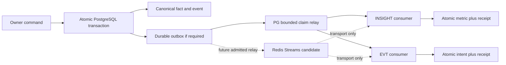

# RM Event Transport R1 — PostgreSQL Outbox first, Redis-ready later
## Owner decision 2026-11-25 · base_dev · source 408aa9d7d86381a6702010ee5608b79364717d48

**Status: OWNER ARCHITECTURE DIRECTION / DESIGN CONTRACT / POSTGRESQL MVP / REDIS DEFERRED / PRODUCTION HOLD.** Owner intends to connect Redis later; design for database outbox now. No Redis dependency, server, configuration, stream, cache or deployment in MVP. No new feature scope or IE-00 admission waiver. This contract refines [Master](RM-INTELLIGENT-COMMERCE-MASTER-R1.md), [DAG](RM-INTELLIGENT-COMMERCE-EXECUTION-DAG-R1.md), [MVP scope](RM-MVP-INTELLIGENCE-EVT-SCOPE-R1.md) and IE-00 A2/B2. Future Redis mechanisms below are proposals requiring separate benchmark/ADR and owner admission, not an instruction to implement now.

## 1. Invariants and topology

MVP: owner command + canonical business event + required outbox intent in **one PostgreSQL transaction**. No remote calls while business locks are held. Existing durable immutable event tables may be the canonical source; A1/A2 determine whether an additive owner outbox is required to support reliable delivery/backfill. Do not duplicate event ownership or add an outbox for its own sake. Do not conflate owner event, transport delivery state, analytic receipt and notification intent. PostgreSQL is source of truth, replay and recovery authority; each consumer has independent delivery/projection receipt and failure handling. No shared consumed flag. INSIGHT never depends on EVT success. Existing IAM outbox is not business transport.

## 2. Stable contracts (logical, not final Java/DDL)

- OwnerEventEnvelope: tenantId, sourceOwner, eventId, eventType, schemaVersion, subjectRef, occurredAt, recordedAt if distinct, sourceVersion only where owner actually supplies it, typed minimal payload or evidenceRef; immutable identity and versioned payload. No secrets/JWT/PII, no synthetic source versions. Identity unique per tenant+owner+eventId; distinguish scheduled occurrences. No global order promise. Per-aggregate ordering where required via qualified versions or owner state/reconciliation; random UUID, timestamp, allocation sequence not commit order.
- TransactionalEventPort: records event/intent inside caller-owned transaction (MANDATORY) where required, never publishes to Redis or network from that transaction. Source owner controls event semantics.
- Transport/claim adapter: bounded batch, claim, lease, generation/fencing, retry, terminal failure and replay; implementation PG-specific in infrastructure. Consumers receive stable envelope, not database row/Redis stream ID as business key. Keep transport-specific acknowledgements and offsets out of business contracts. Avoid speculative generic framework; only interfaces justified by first PLACED → INSIGHT/EVT path.
- ConsumerReceipt: unique tenant+owner+eventId+consumer+projection/handler version (scope refined in A2); effect and receipt in same database transaction, including duplicate/retry detection. For EVT recipient notification use separate unique occurrence+policy revision+recipient+channel and atomic visible in-app receipt. Transport at-least-once, database effects idempotent under qualified conditions; do not claim end-to-end exactly-once delivery.
- PG delivery state: proposed per-consumer intent/receipt, bounded SKIP LOCKED claim, lease expiry and monotonic generation CAS, retry/backoff, dead letter and controlled replay. Claim short transaction; handle separately; stale lease cannot acknowledge or bypass consumer admission. Index/batch/retention and lock DAG after measured review; no deletion while any required consumer lacks terminal/recoverable evidence. No unbounded scans, polling or retry.

## 3. Future Redis options — explicitly not MVP

Redis Streams is candidate transport acceleration (consumer groups, pending entries, reclaim, ACK), not approved architecture or required choice. Redis Pub/Sub is transient and unsuitable as sole reliable event delivery. Redis cache can be considered separately for qualified derived reads, never authoritative balances, price, permissions, revocation, idempotency or financial facts. Redis locks must not replace PostgreSQL transaction fences. For future stream route: PG commit → relay XADD → recorded publication evidence; no atomic PG/Redis commit. Crash after XADD before recorded publication can duplicate. Use stable event ID and existing idempotent receipt; ACK only after consumer PG commit. Lost ACK/reclaim/restart/trim/data loss must recover from PG source/outbox. Publication ACK is not proof consumer business effect; retain replay evidence and independently track consumers. Redis outage leaves committed business transactions durable and backlog visible; recover or explicitly switch to PG delivery using same receipt identities. No dual-active uncontrolled delivery; controlled shadow/no-side-effect test, cutover fencing/routing, replay/reconciliation and rollback; prove no gap and no duplicate business effect. Future ADR covers persistence/HA, retention, consumer-group isolation, access/TLS, backpressure, capacity, recovery and measured cost. No claim Redis necessarily improves latency or removes DB writes.

## 4. Qualification and dependency handoff

| Gate | Required proof |
|---|---|
| A1/A2/A3 | source producers, atomic facts, identity, consumer ownership, event/intent/receipt DDL and permissions reviewed; no invented ordering |
| B2 | commit/rollback source event, stable identity, bounded replay/backfill overlapping live, duplicate and legacy coverage; mandatory source regression |
| B3/B4 | projection effect + receipt atomic; two consumers independent, crash before/after commit, shadow rebuild and SQL oracle |
| E1/E2/E3 | preview no intent; durable in-app/mock, independent consumer progress, lease/fence/retry/revoke and expiry; no external send |
| X1/G1 | mixed PG workload and actual overlap, no lost/double effect, no regression beyond approved bounds; existing Radar 200ms/10% not weakened |
| Future Redis admission | equivalent effect/receipt on same envelope, XADD/ACK crash windows, pending recovery, outage/trim replay, bounded backlog, routing rollback and comparative benchmark; separate CR |

Map these to existing IE-Q08…10/20…30 and MC-03/05; no extra test count claimed. Redis is not an IE-00…G4 dependency. Do not add current Maven dependencies, config, tables or runtime services by this document. Existing outbox design and IE-00B approval remain required. All later code base_dev only; main and production HOLD.
