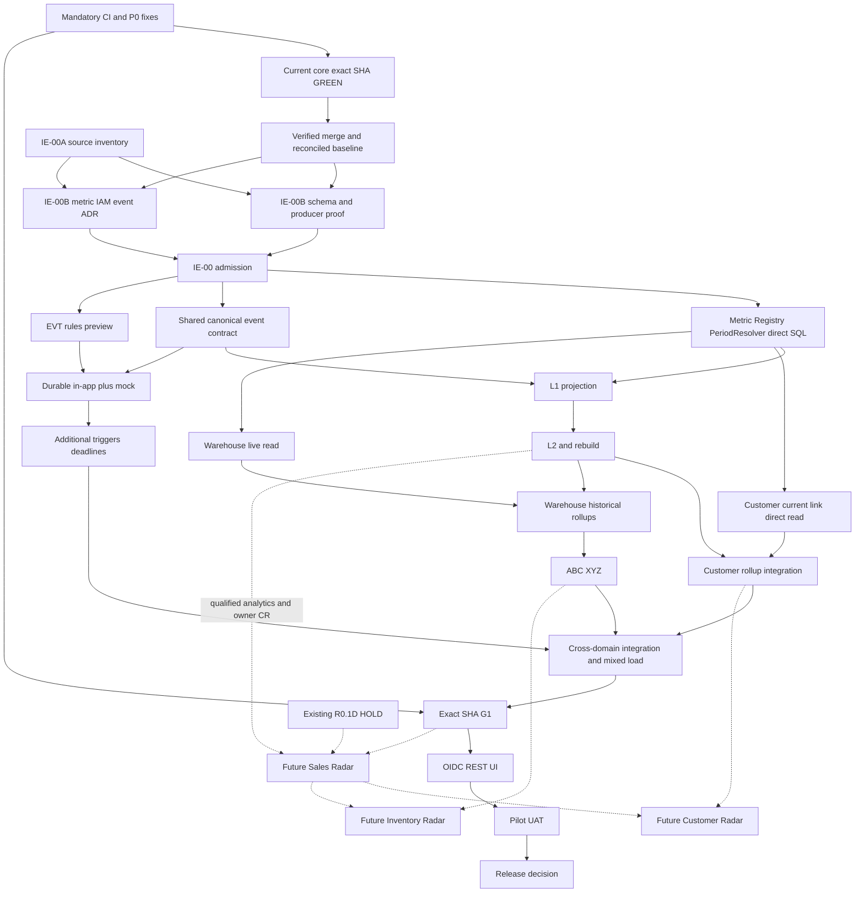

# RM-INTELLIGENT-COMMERCE-EXECUTION-DAG-R1 — Parallel implementation & integration plan
## R1.2 — operative amendment

Owner-approved RM-A3-DEV, 2026-11-25. This supersedes the historical pause and gate descriptions below. PR #9 merged; A2 approved 15/15; source schema run 45591134734 and producer run 45588358130 succeeded. A3 (A3-DEV) admits implementation in base_dev, depending on A0/A2/Q1; A1 remaining runtime evidence is required at A3-QUAL, which depends on A1/B1/B2/E1 and gates G1. All functional exit criteria, G2–G4, C3 and Radar deferral remain intact. No production release. JSON R1.2 is operative. Historical snapshot follows.

## R1.1 · 2026-11-25 · reviewed HEAD e1bced6cf1538bdb9fb7ec22a354255456964e7a

Original inventory snapshot cf09e317f04c79b88c0f64276bc4985ccfa4b3aa retained.

**Status: IE-00A SOURCE REVIEW COMPLETE / IE-00B OPEN / PAUSED UNTIL CORE MERGE / STAGED MVP / PRODUCTION HOLD.** [Inventory](../reviews/RM-INTELLIGENCE-IE-00A-SOURCE-CONTRACT-INVENTORY.md), [Master](RM-INTELLIGENT-COMMERCE-MASTER-R1.md), [Scope CR](RM-MVP-INTELLIGENCE-EVT-SCOPE-R1.md). This document refines stage order, not scope; no code or new permissions. Dependency graph is proposed engineering sequence, not time estimate or new release authorization. User requested logical order with intersections: one common foundation, overlapping Customer, Warehouse, EVT streams where no data/contract dependency, gates at actual convergence. Machine-readable [DAG](RM-INTELLIGENT-COMMERCE-EXECUTION-DAG-R1.json) checked for unique IDs, valid dependencies and acyclicity at creation. No new branches.

## 0. Stabilization-first execution checkpoint

> **Дополнение к очереди 2026-11-25 (owner request: failing Radar tests interfere with core merge).** C3 performance temporarily manual-only (`workflow_dispatch`), not deleted, not marked PASS. Latest observed C3 +12.900% remains unresolved against 10%; current core code integration may proceed without a fresh C3 run only if all remaining mandatory gates including C2 are GREEN and actual GitHub protection permits it. C2 is NOT deferred: preserve concurrency/security checks; fix the denial message contract. Full R0.1D / Radar expansion / production admission still require C3 PASS under unchanged workload/threshold and all prior obligations. No permission bypass or branch-protection changes. Re-enable push C3 before Radar resumption / production admission. If C3 is externally required, PR remains HOLD; branch protection not accessible (403). See [decision](https://github.com/alimbetov/RM/blob/base_dev/docs/reviews/RM-RADAR-C3-TEMPORARY-MERGE-DEFERRAL-R1.md). This narrow exception supersedes earlier statements requiring C3 push PASS for core-only merge, not any qualification or release threshold.

**Operational priority (2026-11-25, owner): STABILIZATION FIRST.** [PR #9](https://github.com/alimbetov/RM/pull/9) base_dev → main remains open on reviewed SHA `e1bced6cf1538bdb9fb7ec22a354255456964e7a`. First close required exact-SHA service/PG/security/migration/CI gates, then merge current core via PR #9 (expected head SHA, no force; verify main and post-merge checks). This is a code integration baseline, NOT expanded MVP acceptance, G2/G3/G4 or production release. Existing CR-MVP-INTELLIGENCE-EVT-01 remains selected but new implementation and IE-00B execution are paused until core merge is verified and base_dev reconciled with main; documentation-only planning may continue. No Radar expansion, no new features during stabilization. After merge revalidate source drift, then A1/A2 in parallel → A3 → B1/B2/E1; current 200ms/10% and all mandatory tests unchanged. If new mandatory failure appears, HOLD remains. [DAG R1.1](RM-INTELLIGENT-COMMERCE-EXECUTION-DAG-R1.md) is the operative execution queue; no new scope. PostgreSQL Outbox first, [Redis deferred](RM-EVENT-TRANSPORT-POSTGRES-OUTBOX-REDIS-READINESS-R1.md), no dependency or partition migration without measured proof.

[C3 FAIL](https://github.com/alimbetov/RM/actions/runs/45542620232/job/138964527506): p95 TASK 4.599→5.193 ms, +12.900% >10%; mixed read p95 2.515 ms, 4966 reads, 4963 overlaps; 2/3 tests. [C2 FAIL](https://github.com/alimbetov/RM/actions/runs/45542620053/job/138964525704): c202 account suspension denial occurred but message "Actor or tenant unavailable" differs from contract "Actor inactive or unknown"; 10/11 tests. Do not weaken assertion or infer entire IAM race suite green; preserve denial classification and re-run both commit orders. [F2 PASS](https://github.com/alimbetov/RM/actions/runs/45542620051/job/138964526239): 8/8, mixed read p95 133.275 ms, commands -3.277%, 250 overlapping reads. Separate CI runs not causal proof.

**Q0/Q1** are explicit integration gates, distinct from G1–G4 for the expanded MVP. Core code merge does not declare BUS-MVP-I1 implemented or authorize deployment. If main already changed in another stream, re-read PR and exact SHA, no stale merge. Latest checked source CI snapshot: in_progress=12, success=35, skipped=2, failure=2; any new failure remains blocker. Source proof for IE-00B not executed. The 32-node/48-edge JSON DAG is authoritative; checked unique IDs, dependencies and acyclicity.

## 1. Critical path and parallelization

Parallel here means independent implementation/review streams, not promised background work, not different Git branches, and not unconstrained multiple edits to same files. Critical path structurally P0 → Q0 → Q1 + A0 → A1/A2 → A3 → B1/B2 → B3 → B4 → W2/W3 → X1 → G1…G4, but EVT or P0 may become actual longest blocker; no durations assumed. Customer/Warehouse direct read design need not wait for full L2. They must use same metric registry and owner filters, then integrate L1/L2 before final acceptance. EVT rule/preview can start after admission without waiting for analytics; delivery requires B2 + E1. Do not make every milestone wait for all unrelated work, but G1 requires all applicable exact-SHA mandatory results.

## 2. Execution register

| ID | Task | Lane | Depends on | Exit / handoff |
|---|---|---|---|---|
| P0 | Core mandatory CI and verified P0 corrections | core | — | existing gates; C2 active, C3 temporary manual-only for core merge |
| Q0 | Current core exact-SHA qualification | core_gate | P0 | remaining mandatory core CI/PG/security/migration and manifest GREEN; C3 narrow deferral; actual PR protection |
| Q1 | Verified core merge and reconciled baseline | core_gate | Q0 | PR #9 expected SHA; main/CI verification, base_dev reconciliation; not release |
| A0 | IE-00A source inventory | foundation | — | source review only, completed in this document |
| A1 | IE-00B migrated schema and source producer/fixture proof | foundation | A0, Q1 | actual schema, coverage, owner event proof, baseline |
| A2 | IE-00B common ADR + metric and IAM/event admission | foundation | A0, Q1 | reviewed definitions and typed scope; no invented grants |
| A3 | IE-00 admission register | gate | A1, A2 | approved source/metric/event contracts; blocked items explicit |
| B1 | IE-01 PeriodResolver + Metric Registry + direct SQL oracle | analytics | A3 | PG/H2 exact periods, numeric, source quality |
| B2 | Shared canonical event contract and owner transactional producer qualification | shared | A3 | stable event key, atomic evidence, current owner regression |
| E1 | IE-06 typed rule/template/audience/preview | evt | A3 | no sends, permission/template proof; may parallel B1/B2 |
| B3 | IE-02A L1 daily projection and idempotent receipts | analytics | B1, B2 | direct SQL reconciliation, duplicate/replay |
| B4 | IE-02B L2 week/decade/month + backfill/rebuild | analytics | B3 | cross-month week, shadow switch, no gaps/duplicates |
| C1 | IE-03A Customer 360 current-link and permission read slice | customer | B1, A3 | direct SQL scope/oracle; no stale identity projection |
| W1 | IE-04A Warehouse 360 live balance and scoped movement view | warehouse | B1, A3 | live owner parity, recorded/event basis, assigned scope |
| E2 | IE-07A durable PLACED in-app intent and delivery + MOCK | evt | E1, B2 | atomic receipt, lease/fencing, retry/revoke, no external |
| C2 | IE-03B Customer 360 L1/L2 integration | customer | C1, B4 | qualified cohort and current link reauthorization |
| W2 | IE-04B Warehouse historical rollups/reconciliation | warehouse | W1, B4 | opening/closing, returns and transfers, unknown history |
| W3 | IE-05 ABC/Pareto/XYZ | warehouse | W2, B4 | approved thresholds, unit and complete history, UNKNOWN allowed |
| E3 | IE-07B other admitted triggers and deadline scheduling | evt | E2 | owner transition proof and clock/expiry/renew/reschedule gates; no task mutation |
| X1 | Cross-module MC-01…05 and mixed load | integration | C2, W3, E3, B4 | owner ledger parity and independent consumers; no regressions |
| G1 | IE-08 integrated service qualification exact SHA | gate | X1, P0 | all required CI/PG/BSR/previous tests pass; immutable candidate |
| G2 | IE-09 G2 real OIDC/REST/PWA | gate | G1 | J1 + I1 role-safe browser journeys |
| G3 | IE-09 G3 controlled pilot/UAT/restore | gate | G2 | signed user acceptance and restore |
| G4 | IE-09 G4 independent release admission | gate | G3 | explicit approval, production remains HOLD until decision |
| R0 | R0.1D close existing Radar qualification | radar_deferred | A0 | mandatory existing P0/CI remain now, planned work paused; 137 baseline and 60 families, thresholds |
| R1 | R-01 Smart Deadline R0.2 | radar_deferred | R0 | explicit owner resumption; G2 for UI |
| R2 | R-02 Universal Signal + Sales Radar | radar_deferred | R0, B4, G1 | A1–A6 by vertical and separate CR; proposed post-MVP unless explicit exception |
| R3 | R-03 Customer Radar | radar_deferred | R2, C2 | A1–A6, current identity and history |
| R4 | R-04 Inventory Radar | radar_deferred | R2, W3 | A1–A6, current stock and quality |
| R5 | R-05 Financial/FX Radar | radar_deferred | R2 | separate finance/FX qualified source gate not satisfied by these deps |
| R6 | R-06 Predictive Radar | radar_deferred | R2 | separate features/labels/temporal validation, enough history/approval |
| R7 | R-07 Action Advisor | radar_deferred | R2 | reliable signals, explicit owner command admission; ML optional |

MVP stages retain original IE numbering; A/B/C/W/E/X labels split existing gates only. R-00…R-07 not new MVP authorization; R1 (Smart Deadline) does not block Sales provider conceptually but requires explicit resumption. R2 is earliest future signal slice only after R0.1D + data/owner gates; G1 here is proposed conservative prerequisite, actual future schedule per separate CR. R5–R7 additional domain/model/action gates not represented as completed graph nodes. No fake PASS because graph predecessors listed; external conditions must be proven. Current source review complete at A0; P0/Q0/Q1 next, A1/A2 paused until verified merge, all feature code nodes blocked by A3.

## 2A. Transport boundary — PostgreSQL first

[Event Transport R1](RM-EVENT-TRANSPORT-POSTGRES-OUTBOX-REDIS-READINESS-R1.md): A2 fixes owner envelope, per-consumer receipts and transaction boundaries; B2 qualifies durable PostgreSQL outbox/owner events, B3/B4 and E2/E3 use independent idempotent consumers. Redis is a deferred transport candidate only, no current dependency or graph node. Future adapter admission requires replay/cutover/failure proof, preserving PG authority. No new scope or gate waiver.

## 3. Intersections and single-owner file/contract discipline

| Intersection | Shared contract and primary owner | Parallel work allowed | Convergence / conflict avoidance |
|---|---|---|---|
| SALES/INVENTORY → INT & EVT | B2 source event identity/envelope, transaction atomicity, owner event fields | B1 pure period/registry and E1 typed rules after A3 | B2 owner reviewer approves emitter/source changes once; two consumers separate receipts. No second bus |
| Metric Registry → Customer/Warehouse | B1 canonical metric definitions, periods, units, currency, quality | C1/W1 direct owner reads after B1 | C2/W2 compare B4 projection to direct SQL; no duplicate KPI implementations |
| CRM link IAM → Customer and future Radar | current confirmed mapping and active buyer fence from SRC-14 | source tests during A1/A2 | one admission policy; no stale customer cached aggregates; C1 and later R3 reuse |
| Inventory owner → Warehouse/ABC/XYZ and future Radar | live available + movement facts, posting basis, returns, scope | W1 read slice while B3/B4 mature | W2/W3 method and coverage versioned; R4 reads same qualified results |
| TASK/CRM → EVT and future Radar | due date/contract expiry owner semantics, canonical versions | E1 configuration preview and E2 PLACED first | E3 deadline proof, no automatic task changes; R0.1 timing unchanged |
| Shared DB/IAM | locks, migration master, permissions/module registry, resource budgets | disjoint pure code and tests; one DDL/IAM owner at a time | merge each small atomic change to base_dev using exact parent CAS, next free Liquibase changeset, no migration rewrite; review lock DAG and shared mixed load |
| EVT → Radar | current EVT source triggers only; future signal adapter separate IDEA-06 | no Radar-to-EVT implementation now | future separate scope/consent and MC-07; no circular dependencies |

Single branch: base_dev. Before every write fetch HEAD/diff; do not overwrite parallel changes. Integration commits small, test evidence tied to exact SHA. Coordinate edits to master SQL, DomainPermission/DomainModule, common event DTO and CI manifest via one logical owner/review at a time; do not split a transaction contract across incompatible commits. Use explicit stubs only if disabled/fail-closed and regression proven; never activate unfinished consumer. No main/production, no REST/UI before integrated G1. During frozen RC qualification only approved P0 fixes; if change necessary, new RC and repeat gates.

## 4. Wave plan and handoffs

| Wave | Primary track | Overlapping track | Do not start yet |
|---|---|---|---|
| Pre-0 | P0 → Q0 → Q1 current core stabilization and merge | documentation reconciliation only | IE-00B and new feature code until verified merge |
| 0 | A1 migrated schema + producer/fixture baseline | A2 IAM/metric/event design; existing P0 | Java/DDL until A3 |
| 1 | B1 direct analytical core | B2 source envelope; E1 preview | L1 until B1/B2; delivery until E1/B2 |
| 2 | B3 L1 and B4 L2/recovery sequential | C1 current-link Customer, W1 live Warehouse, E2 in-app | C2/W2 projection claims until B4; E3 deadline until E2 |
| 3 | C2 and W2 integration → W3 ABC/XYZ | E3 admitted triggers/deadlines | X1 until all applicable evidence |
| 4 | X1 integrated PG load/security/recovery | existing mandatory regression | release, UI until G1 |
| 5 | G1→G2→G3→G4 | defect repair only per gates | no auto production |
| 6 (future) | qualified analytics → R0/R2 minimal Sales provider | R1 Smart Deadline and other provider design if explicitly admitted | expansion/ML/finance absent data; no premature universal engine |

Proposed architecture decision: start direct SQL/oracles before materializing L1/L2 to learn grain and source gaps; choose existing immutable facts first, only add producer/outbox if needed, verify safe replay. Do not create 9 microservices or duplicate FIN runtime. EVT initial in-app PLACED trigger is independent of ML and avoids deadline scheduler until common delivery proven. Tradeoff: earlier partial Customer/Warehouse reads may be useful engineering deliverables but cannot claim final I1 until rollup and security gates pass.

## 5. Integration matrix and CI

| Gate | Reuse / required proof |
|---|---|
| A3 | IE-00B register field/source/permission/time/quality, approved metric semantics and scope, actual schema/coverage fixtures. No code prior. |
| B1/B3/B4 | F2R-01…09,23–28,32 as applicable; IE-Q01…10/29/30; direct SQL independent of projection, source coverage, commit/rollback and rebuild. |
| C1/C2 | IE-Q11…13/19, F2R-14…17; link revoke/dispute/suspend and active buyer scope; same currency/cohort, no PII leakage. |
| W1/W2/W3 | IE-Q14…19, F2R-10…13/20…22; live balance, paired transfer/return, no valuation claim; unknown XYZ. |
| E1/E2/E3 | IE-Q20…28; preview zero intent, closed placeholders, recipients, exact one in-app, lease/retry/revoke, mock external, deadline invalidation. |
| X1/G1 | MC-01…05, IE-Q29…32, all source owner mandatory regression and BSR; exact SHA and actual overlap; keep Radar current gates, no skips/waiver. |
| G2…G4 | BUS-MVP-J1, QR-MVP-J1, BUS-MVP-I1 and MC-08; real OIDC, browser roles, signed UAT, rollback/restore and explicit admission. |
| R future | existing 60 RAD/CAL and 48 BV families, MC-06/07; separate scope, qualification of provider data, model/financial/EVT conditions. |

Families overlap; map concrete cases to normative IDs without double counting. Existing threshold 200ms and 10% for current Radar unchanged; new performance budgets require predeclared workload and approval. Raw plans/samples, real PostgreSQL 17, clean/populated Liquibase, H2 compatibility, signed access token, no test-only bypass, no release claims until exact-SHA and G4.

## 6. Immediate work queue

**P0 → Q0 → Q1** are the immediate execution tasks; A1 + A2 follow verified merge and revalidation of source drift. A1: obtain actual migrated schema and owner event proof using PostgreSQL qualification fixtures, independently reconcile 8 candidate metrics, catalog null/legacy and ordering gaps. A2: owner/prefix/IAM/zone/event/metric definition ADR and scoped contract; start with safe SKU-native quantities, booked amounts only, canonical identity, first PLACED event and typed in-app. A3 accepts only documented evidence and decisions; unresolved financial, UOM, identity or XYZ history remain blocked/UNKNOWN rather than fake data. Then B1, B2 and E1 may begin concurrently in non-overlapping changes. The current pass did not execute tests or write Java/SQL. Next implement after admission, no unconditional time estimate.

## Revision history
R1.0 — 2026-11-25: 30 dependency nodes, validated DAG, cross-track integration plan, no scope extension.

R1.1 — 2026-11-25: 32 nodes / 48 edges; add Q0/Q1 current core qualification/merge gates, preserve parallel streams after merge; update evidence and transport boundary; no code or release admission.
