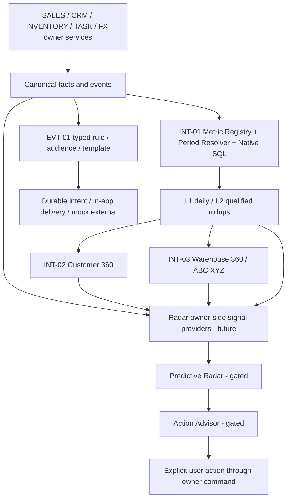
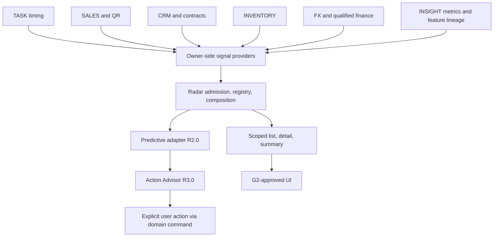

# RM-INTELLIGENT-COMMERCE-MASTER-R1 — Unified Technical Specification
## Редакция R1.0 — Analytics First · Customer 360 · Warehouse 360 · EVT · Business Radar

**Дата:** 2026-11-25. **Репозиторий:** alimbetov/RM, **ветка:** base_dev.  
**Source snapshot SHA:** b06f3680a93863b8c6c2c1824d053717a6d30798.  
**Статус:** MASTER SPEC / SCOPED MVP INT-01…03 + EVT-01 SELECTED / RADAR EXPANSION DEFERRED ANALYTICS FIRST / PRODUCTION HOLD.  
**Решение владельца:** объединить в общее ТЗ четыре ранее выбранных направления MVP и полное ТЗ расширения Radar. Это не самостоятельное разрешение новых Radar-функций, ML, внешних рассылок или production. Действующее CR-MVP-INTELLIGENCE-EVT-01 сохраняется; дальнейшее включение Radar R0.2/R1+ в фактический MVP требует отдельного явного решения о возобновлении и scope.

> **IE-00A (2026-11-25):** [Source & Contract Inventory](../reviews/RM-INTELLIGENCE-IE-00A-SOURCE-CONTRACT-INVENTORY.md) и [Execution DAG R1](RM-INTELLIGENT-COMMERCE-EXECUTION-DAG-R1.md) уточняют общую последовательность §C: independent A1/A2 → A3 admission → parallel B1/B2/E1 → bounded Customer/Warehouse/EVT convergence. Source inventory complete for MVP candidates; IE-00 admission OPEN, no code/DDL until gate. Radar deferred, mandatory P0/regression preserved. DAG refines original milestones, does not expand scope.

## A. Назначение, границы и нормативность

RM становится единой платформой интеллектуального управления торговым бизнесом: учёт фактов → достоверная аналитика → управленческие представления → контролируемые уведомления → объяснимые сигналы → прогнозы и рекомендации. Не строить независимую ERP или финансовую систему; не добавлять третий order/stock/price engine. Два продукта RM Business и RM QR Commerce, обязательные BUS-MVP-J1 и QR-MVP-J1 неизменны. BUS-MVP-I1 — дополнительный обязательный сценарий расширенного MVP согласно CR. Будущий BUS-RADAR-I2 — отдельный acceptance slice, не обязательный для текущего MVP без нового CR.

| Контур | Scope / решение | Граница ответственности |
|---|---|---|
| INT-01 RM Intelligence | MVP SELECTED, IE-00 gate | Metric Registry, Period Resolver, Native SQL, L1/L2, quality, lineage/rebuild |
| INT-02 Customer 360 | MVP SELECTED | Scoped CRM/SALES/TASK/contract analytical views |
| INT-03 Warehouse 360 + ABC/Pareto/XYZ | MVP SELECTED | Scoped stock/movement/reservation analytics and classification |
| EVT-01 Event Builder | MVP SELECTED | Typed rules, recipients, safe templates, in-app outbox/delivery, mock external |
| RAD-BASE Task Radar R0.1 | Existing code / mandatory qualification HOLD | Keep timing authority, 60 RAD/CAL families, existing CI |
| RAD-EXT Business Radar R0.2/R1+ | INCLUDED IN MASTER PLAN / DEFERRED_ANALYTICS_FIRST | Read-only signals after data qualification and owner resumption |
| PRED/ADVISOR Radar R2/R3 | POST-MVP / gated future | Tribuo candidate, validated prediction, explicit human-approved actions |

**Нормативная иерархия:** [Platform Standard](../architecture/RM-PLATFORM-STANDARD-R2.md), [MVP Freeze](../strategy/RM-MVP-CLOSURE-FREEZE-R1.md), [Product Strategy](../strategy/RM-PRODUCT-STRATEGY-R2-SMB-QR.md), утверждённые IAM/SALES/INVENTORY/QR/FX state and consistency contracts; CR-MVP-INTELLIGENCE-EVT-01 и CR-MVP-KF-RADAR-01/01A. Этот master управляет последовательностью и интеграционными границами, не заменяет и не ослабляет канонические domain contracts. Часть I и II ниже содержат полный текст исходных ТЗ в редакциях на source SHA (только заголовки адаптированы для объединения). Исторические формулировки внутри частей не изменяют статус master §A. При обновлении дочернего ТЗ фиксировать новый snapshot SHA и синхронизировать соответствующую часть и матрицу; не поддерживать противоречивые копии. При конфликте — более строгий норматив и отдельный decision record, до решения HOLD.

Исходные нормативные документы:
- [Intelligence + EVT scope R1.0](RM-MVP-INTELLIGENCE-EVT-SCOPE-R1.md), [snapshot](https://github.com/alimbetov/RM/blob/b06f3680a93863b8c6c2c1824d053717a6d30798/docs/spec/RM-MVP-INTELLIGENCE-EVT-SCOPE-R1.md).
- [Radar Vision R1.1](RM-RADAR-VISION-R1-INTELLIGENT-BUSINESS-CONTROL-CENTER.md), [snapshot](https://github.com/alimbetov/RM/blob/b06f3680a93863b8c6c2c1824d053717a6d30798/docs/spec/RM-RADAR-VISION-R1-INTELLIGENT-BUSINESS-CONTROL-CENTER.md).
- [INSIGHT-R1](RM-INSIGHT-R1-OPERATIONAL-ANALYTICS-PERFORMANCE.md), [FIN Adaptation](RM-INSIGHT-FIN-ADAPT-R1-CRM-ANALYTICS-COMPUTATION.md), [Task Radar R0.1](RM-KF-RADAR-R0.1-OVERDUE-TASK-SIGNAL-R1.md), [Timing Contract](RM-KF-RADAR-TASK-TIMING-CONTRACT-R1.md), [Smart Deadline R0.2](RM-KF-RADAR-R0.2-SMART-DEADLINE-REMINDER-TEXT-R1.md), [Smart FX Shield](RM-CUR-R2C-SMART-FX-SHIELD-CONTROLLED-AUTO-PRICING-R1.md), [TASK durable outbox](RM-TASK-01B-R3.2B-SLA-POLICY-DURABLE-OUTBOX-FOUNDATION.md).
- [Банк идей](../ideas/RM-IDEA-BANK-R1.md). Весь остальной банк PARKED, ранее выданные узкие исключения сохраняются.

## B. Общая архитектура и единственный источник истины

INSIGHT/INT owns metric definitions, exact calculations, period/timezone/currency/UOM semantics, evidence quality and derived projections. Customer/Warehouse 360 are use-case read compositions, not new canonical customer or stock stores. EVT owns policy, audience admission, template version, intent, delivery state and receipts. Radar owns signal catalog, relevance, ordering, explanation and recommendation composition, not accounting, price or stock math. Canonical owner services reauthorize and revalidate before any user action. Shared event identity does not imply a common mutable receipt table; each consumer has its own idempotency/replay state. Existing IAM mail outbox is not the business event bus. No analytics dependence on EVT delivery. No feedback loop where a notification creates a source fact. Radar-to-EVT alerts (IDEA-06) are future optional integration; not implied by core EVT, require explicit separate scope and consent. Financial facts absent → UNKNOWN/NOT_MEASURABLE, never zero. FX preview/hold is not autonomous publication.

Logical data flow (not new schema authorization): OwnerFactRef(tenant,owner,kind,subject,sourceEventId,sourceVersion,eventAt) → MetricResultRef(metricCode,methodVersion,scope,period/asOf,unit,currency,quality,evidenceDigest) → domain view → RadarSignalSnapshot. EVT consumes admitted source trigger and versioned policy, not free text or model output. Reference identifiers are conceptual, actual DDL/classes chosen after IE-00 source review. No direct cross-domain DML; no FIN runtime, new microservices, Kafka/Redis/ClickHouse, arbitrary SQL DSL, hidden PII, automatic business commands.

## C. Общий roadmap и зависимости

| Stage | Deliverable | Entry / exit |
|---|---|---|
| M0 / IE-00 | Source & Contract Admission | First active task: exact HEAD owner/schema/event/permission inventory, 6–8 metrics, ABC/XYZ rules, EVT source matrix, workload and independent oracle |
| M1 / IE-01 | Metric Registry, Period Resolver, Native SQL | IE-00 admitted; PG/H2 exact period/units/scope |
| M2 / IE-02 | L1/L2, idempotent facts, backfill/rebuild | M1 reference oracle; populated upgrade, independent reconciliation and replay/race proof |
| M3 / IE-03 | Customer 360 | Qualified client links, SALES facts and permissions; source parity |
| M4 / IE-04 | Warehouse 360 | Qualified movement/reservation/return facts and live stock parity |
| M5 / IE-05 | ABC/Pareto/XYZ | M4 + sufficient complete demand history and approved method; UNKNOWN allowed |
| M6 / IE-06 | EVT typed rules, template/audience/preview | Can proceed in parallel after IE-00; canonical event and IAM admission independent from analytics |
| M7 / IE-07 | Durable in-app outbox + mock delivery | M6 approved; PG claim/lease/stop/crash/retry and consent checks |
| M8 / IE-08 | Expanded MVP integrated G1 | M1–M7 applicable proofs, mandatory existing CI, exact SHA, immutable RC |
| M9 / IE-09 | G2/G3/G4 and BUS-MVP-I1 | Real OIDC/REST/UI only after G1; pilot and release separate |
| R-00 / R0.1D | Resume qualification of existing Task Radar | Unclosed 137/137 baseline and 60-family RAD/CAL audit; current 200ms/10% unchanged; mandatory tests never waived |
| R-01 / R0.2 | Smart Deadline Text | Explicit resumption, R0.1D, G2 admission for UI; no new business writes |
| R-02 / R1.0 + R1.1 | Minimal common signal contract + first Sales provider | Analytics A1–A6 per slice, explicit owner CR, qualified M1/M2 sales metrics, R0.1D |
| R-03 / R1.2 | Customer & Contract Radar | M3 source/metric/consent and time policy; reuse evidence, no second Customer 360 |
| R-04 / R1.3 | Inventory Radar | M4/M5 verified balances and classification; forecast separate |
| R-05 / R1.4 | Financial & FX Radar | Qualified canonical financial data and FX revisions; missing ledger/COGS blocks dependent signals |
| R-06 / R2.0 | Predictive Radar | Validated features, sufficient historical observations, temporal baseline, shadow/pilot |
| R-07 / R3.0 | Action Advisor | Deterministic recommendation first; fresh permission/version, explicit user action; no automatic commands |

M0–M9 = current staged expanded MVP work; R-00…R-07 = subsequent Radar plan. This is an execution order, not 18 independently authorized modules. R-00 mandatory regression/P0 corrections remain applicable now, do not intentionally disable tests or conceal open failures. Scope pause of planned Radar enhancements remains. An owner-approved future Radar slice may resume after the corresponding analytical vertical passes A1–A6, R0.1D and relevant release gates, not after all ML/financial modules. Existing base J1 qualification proceeds independently; any phased release requires separate decision. Global G1 requires mandatory exact-SHA CI, no cherry-picking favorable retries. No automatic release from documentation, tests, or G1.

## D. Cross-domain signal dependency map (future Radar)

| Signal IDs | Analytical source / owner facts | Mandatory gate / no-go |
|---|---|---|
| T01–T03 | TASK timing snapshot and immutable completion/due changes | R0.1D, R0.2 separate; effective/original evidence independent |
| S01–S05 | SALES order/quote/pickup/fulfillment/return history; INT booked/cohort/status metrics where relevant | M1/M2 source audit; no false available reserve, no pickup secret or automated confirm |
| C01–C04 | CRM contracts, authorized interactions, M3 Customer 360 | Qualified identity links, period coverage, consent, unknown history; no churn claim |
| I01–I04 | INVENTORY live balances/reservations/stocktake + M4/M5 movement/ABC/XYZ facts | Live stock is canonical; no forecast without history; no automatic stock mutation |
| F01–F05 | Finance owner ledger if available; approved FX anchor/rate/guardrail evidence | No order-as-debt, no missing COGS margin, no mixed currency sum, no FX_AUTO side effect |

Signal composition uses authorized type-specific providers, stable scoped keys and source versions, bounded top-K and keyset, explicit freshness and partial/error states. No global consistency promise across asynchronous projections; detail reauthorization and owner command revalidation required. If summary counts are needed, separately qualified aggregate, never count inferred from page size. Provider error/missing data must not silently resolve risk. See full 21-signal catalog in Part II.

## E. Unified non-functional & acceptance controls

- Identity: verified access token, tenant/owner permissions at each service read, policy change, dispatch and action; no implicit global-admin wildcard, no fabricated IDs or cross-tenant counts. Signed JWT/local JWKS, revocation/suspension/expiry races, zero unauthorized side effects.
- Data: exact BigDecimal, versioned periods/units/currency/methodology, no false historical completeness, immutable source truth. Return dispositions and transfers respected; booked is not paid revenue. Projection receipt+update atomic, rebuild/replay independent oracle.
- Performance: PG 17, H2 compatibility; real populated 1k/10k/100k and dense/sparse/history/tenant skew, raw p50/p95/p99 and throughput, actual concurrent overlap, plans/locks/CPU/IO/GC. Existing Radar gate p95 <=200 ms and TASK degradation <=10% unchanged. New INT/EVT and cross-domain targets must be approved before qualification; do not assert new SLA or waive previous failures. Bounded reads/worker batches, no unbounded polling, no N+1.
- Release: clean/populated Liquibase upgrade, immutable applied changesets, independent source-of-truth SQL and exact-SHA manifest, no unexpected skip, G1 service closure → G2 real OIDC/narrow REST/PWA → G3 UAT/pilot/restore → G4 independent admission. Main untouched; production HOLD; no live external SMTP/SMS/push, campaign, ML or AUTO by master document.

**Acceptance inventory:** Part I retains 32 IE-Q families; Part II retains 48 BV families. 80 existing planned families in the consolidated document, not 80 executed tests or mutually independent scenarios. The 60 RAD/CAL and 32 F2R families, BSR/core and domain regressions remain linked normative dependencies, not added to totals. The following 8 integration families are additional planning rows, to be mapped to concrete methods and deduplicated against existing tests.

| Master ID | Integrated scenario | Expected evidence | Stage |
|---|---|---|---|
| MC-01 | SALES order/confirm/cancel/return → canonical events → INT L1/L2 → Customer 360 | Source and projection reconcile by eligible cohort/currency; no double count, no paid claim | M2/M3 |
| MC-02 | INVENTORY receive/transfer/reserve/fulfill/return → Warehouse 360 → ABC/XYZ | Owner balance/movement parity; quarantine unavailable; same SKU/unit and adequate history | M4/M5 |
| MC-03 | Committed order event consumed by INT and EVT independently; delivery fails | INT unchanged, no lost/duplicated projection; bounded retry, exactly one visible in-app after recovery | M7 |
| MC-04 | Revoke/suspend × metric/detail/EVT dispatch, both commit orders; same UUID across tenants | Real IAM fences, no unauthorized result/count/delivery, no PII | M8 |
| MC-05 | Backfill/replay/rebuild/crash with live SALES/INVENTORY commands | Correct receipts, atomic projection switch, fresh/partial state, no command regression beyond approved bounds | M8 |
| MC-06 | Future Sales/Customer/Inventory Radar reads qualified metrics vs stale/missing/new methodology | Correct signal/UNKNOWN, stable identity, no duplicate count, detail reauthorization | R-02…R-04 |
| MC-07 | Future Radar signal → explicitly admitted EVT alert / advisor action | Separate policy/consent gates; no auto command; stale state conflicts, dedup and owner action audit | future separate scope |
| MC-08 | Full BUS-MVP-J1 + QR-MVP-J1 + BUS-MVP-I1, then optional BUS-RADAR-I2 | Real user/browser UAT, canonical order/stock unchanged, required exact-SHA evidence and release decision | M9 / R future |

MC-01…08 are proposed integration families; no tests executed here. Requirements mapping records family → applicable subcases → test methods → engine → source/evidence SHA → status PASS/FAIL/HOLD/DEFERRED with reason. Never mark a whole family PASS from one superficial test. No inflated totals.

## F. Product journey and open decisions

MVP I1: seller opens a customer card, compares booked orders and interaction history; warehouse user sees live available and movements; owner sees ABC/XYZ with selected period/metric and explicit unknown; authorized operator previews and enables safe in-app notification and receives deduplicated evidence from a canonical source. Existing J1 checkout/stock/pickup/return unaffected. Future I2: seller opens Radar, sees a verified Sales/Customer/Inventory signal, examines asOf/method/source/permission, opens owner detail, explicitly performs allowed action, refresh shows resolution only from current source. If provider fails or facts stale show unknown/partial; no automatic remedy.

Open before implementation: source/owner and permissions, approved metric definitions and quality, daily/rollup dimensions, ABC/XYZ boundaries and coverage, event types/recipient roles/template/schedule limits, PG workload and targets, migration/worker topology. Before Radar: R0.1D, A1–A6 by vertical, priority/comparator, thresholds and stale policy, separate scope decision; financial/ML/outbound events only once corresponding contracts admitted. Suggested numerical thresholds remain proposals until reviewed. **Immediate priority IE-00**; implementation of analytics/EVT after that admission. Radar extension remains planned, not active, by Analytics First. No code, migrations, REST/UI or test results delivered by this master.

## Part I — Expanded MVP: complete Intelligence & EVT specification

## RM-MVP-INTELLIGENCE-EVT-SCOPE-R1 — Intelligent Commerce MVP
### R1.0 — Analytics First + Event Foundation

**Дата:** 2026-11-25. **Source inventory SHA:** e3b2b999991711f0ae3c582488f419210291e9ce. **Repository:** alimbetov/RM, base_dev only.  
**Decision:** CR-MVP-INTELLIGENCE-EVT-01 — владелец выбрал TOP-1…4 из рейтинга банка идей для MVP.  
**Status:** OWNER SELECTED / SCOPED MVP DEVELOPMENT / STAGED ADMISSION / PRODUCTION HOLD.  
Это письменное расширение MVP, а не доказательство реализации или release. Допускается разработка только описанных срезов после соответствующих входных gates. Остальные идеи остаются PARKED. Предложенные ниже числовые параметры и точные продуктовые метрики требуют утверждения в slice review, не являются production SLA.

### 1. Scope, priority and non-goals

Сохраняются RM Business и RM QR Commerce; BUS-MVP-J1 и QR-MVP-J1 неизменны, не добавляется третий order/stock engine. Новый дополнительный пользовательский acceptance slice BUS-MVP-I1 (аналитика и события) — часть RM Business. Базовые J1 должны продолжать квалифицироваться независимо, но расширенный MVP не объявляется полностью принятым без I1. Если требуется выпустить базовый J1 раньше, отдельное owner decision о phased release, без ложного расширенного MVP PASS. Не задерживать завершение текущих P0/security fixes из-за будущих модулей. Уже квалифицируемый frozen candidate не менять незаметно; зафиксировать новый candidate после staged work.

| Workstream | Bank IDs | MVP result | Excluded |
|---|---|---|---|
| INT-01 RM Intelligence | IDEA-17, enabling IDEA-02 | 6–8 core metrics, source admission, periods D/W/DEC/M/Q/H/Y where qualified, bounded Native SQL, L1 daily + L2 approved rollups, lineage and rebuild | FIN runtime, 166 forms, generic DSL, universal reports/graph, Tribuo |
| INT-02 Customer 360 | IDEA-01 | scoped client card, linked order/interaction/contract history, order count/amount, avg order, recency, comparable activity | churn probability, external enrichment, profiling without consent, AR/payment claims |
| INT-03 Warehouse 360 + ABC/XYZ | IDEA-03/04 | per warehouse/SKU balances, reservations, movements, turnover where authoritative, ABC value/count/quantity basis with UOM/currency constraints, XYZ qualified demand history | automatic purchasing/reorder, COGS/FIFO without source, forecasting, intercompany consolidation |
| EVT-01 Event Builder | IDEA-07 | canonical events/deadlines, closed typed rules, explicit audience, versioned safe templates, bounded schedule, durable intent/outbox, in-app delivery + mock external adapter | mass marketing, arbitrary scripts/SQL, actual SMTP/SMS/push before separately approved delivery gate, auction events, invoice/payment reminders without authoritative ledger |

IDEA-06 advanced INSIGHT-to-EVT alerts, IDEA-05 Tribuo, IDEA-18 expanded Radar, IDEA-08/09 auctions/chat, IDEA-10 FX_AUTO expansion, IDEA-11–16 additional features remain in prior scopes. R0.1 Radar code and existing CI retained; planned enhancement deferred Analytics First, unresolved mandatory gate is not waived. Smart Deadline R0.2 still PARKED. No new microservices, Kafka/Redis/ClickHouse, second event bus, new branch, merge main or production activation. Do not copy FIN IAM, schemas or financial semantics.

Normative:
- [Freeze](../strategy/RM-MVP-CLOSURE-FREEZE-R1.md) new explicit exception CR-MVP-INTELLIGENCE-EVT-01; [Platform Standard](../architecture/RM-PLATFORM-STANDARD-R2.md), [Product Strategy](../strategy/RM-PRODUCT-STRATEGY-R2-SMB-QR.md).
- [INSIGHT-R1](RM-INSIGHT-R1-OPERATIONAL-ANALYTICS-PERFORMANCE.md), [FIN Adaptation](RM-INSIGHT-FIN-ADAPT-R1-CRM-ANALYTICS-COMPUTATION.md).
- [TASK SLA & Outbox](RM-TASK-01B-R3.2B-SLA-POLICY-DURABLE-OUTBOX-FOUNDATION.md) — reference patterns, not blanket authorization for TASK R3.2B/B1–B4 or R3.2C.
- [Bank of Ideas](../ideas/RM-IDEA-BANK-R1.md), [EVT discovery Issue #11](https://github.com/alimbetov/RM/issues/11), [Radar Vision](RM-RADAR-VISION-R1-INTELLIGENT-BUSINESS-CONTROL-CENTER.md).
Preceding post-MVP statements in INSIGHT/FIN/Bank are superseded only for the bounded INT/EVT slices in this CR; other prohibitions and all safety gates survive. Use existing contracts where compatible, record conflicts, no duplicate implementation.

### 2. Source-first implementation and ownership

Initial inspection confirms existing TASK/CRM/SALES/INVENTORY/FX services and immutable histories. No complete dedicated analytics/event engine established by inventory. Before code, produce source field-to-metric/event mapping on exact HEAD; verify DDL, nullable legacy records, source transition producers, event IDs, tenant/warehouse/SKU/customer dimensions, accepted price snapshot, return disposition, actor/roles, timestamps, transaction boundaries, actual populated history. Identify events missing stable ID, event time, customer attribution, UOM or monetary snapshot as BLOCKED or PARTIAL, never infer. Source owner remains truth; no cross-domain arbitrary writes. Owner-side SQL and shared approved read contracts, not a separate canonical data warehouse. Use source canonical identity links, no email fuzzy matching. IAM/tenant role check at each read, write, job delivery and drilldown. All tenant-owned keys composite.

INSIGHT and EVT consume same canonical source events; INSIGHT does not depend on notification delivery. Existing IAM email/outbox is not a generic business event bus; no reusing identity secrets or delivering commercial mail as IAM. If source event producer/outbox needs changes, additive Liquibase only after review/clean+populated tests; maintain canonical business transaction atomicity. No outbound I/O under owner locks. No source mutation from analytics, alerts or recommendations. Runtime Spring Boot + Java + PostgreSQL, use existing libraries; H2 compatibility and PG real qualification mandatory. F2R design from FIN is adaptation of patterns not runtime/code import without review.

### 3. INT-01 — analytical foundation

First choose 6–8 mandatory core metrics from source inventory: placed order count, booked amount by currency, confirmed order count, fulfilled order count, cancelled order count, stock in/out by SKU/location/UOM, live available (on_hand-reserved). Status event counts not distinct cumulative order populations; placed and confirmed not added as independent orders. Booked amount not revenue, cash or debt. Returns separate authorized facts; no fake net sales if return monetary evidence missing. Average order = ratio of sums on matching cohort, not mean of daily averages. Inventory transfer internal two legs, per warehouse signed; company total net zero only for matched unit/SKU transfer. Reservations not movements. Stock as-of/gauge never sum across periods. No mixed currency/UOM sum without approved normalization.

Metric Registry: code, version, owner, source and required dimensions, operator, currency/UOM, cohort, event/asOf time, quality semantics, scope, precision, permitted filters, rollup legality, method SHA. Closed typed SQL expressions and prepared bind parameters. PeriodResolver D/W/DEC/M/Q/H/Y half-open intervals, ISO week-year, tenant IANA zone and DST, daily L1 and independent L2 week/decade/month rollups; Q/H/Y only if validated from compatible grains. Distinct counts and ratios not additive; use eligible facts/denominator or separately qualified set semantics. Source quality READY/PARTIAL/MISSING/STALE/NOT_MEASURABLE; zero only when complete scope proven. Result metadata asOf, watermark semantics, method/source version and data coverage; no synthetic global commit watermark. Exact BigDecimal and units, no float for money.

Sequence: reference direct Native SQL oracle → approved owner source/outbox contracts → L1 idempotent application → L2 → rebuild/backfill and freshness. Each receipt atomic with projection update; uniqueness composite source event+projection version; no max(sequence) assumption. Rebuild shadow version, reconcile, drain, atomic switch, previous version retained. Bounded backfill, retry, failure handling; no eager partitioning, benchmark and ADR first. Read model not authoritative for checkout/reserve/fulfill. Full F2R-01…04 and scoped F2R-05 acceptance; F2R-06/07 remain outside except minimal G2 read presentation. No dependency graph unless required by selected metrics.

### 4. INT-02 — Customer 360 MVP

Customer selector scoped by CRM permission + relevant SALES/TASK/contract rights, no aggregate leakage if domain denied. Profile history with bounded keyset; customer identity only canonical link, explicit unresolved attribution. Metrics: placed/confirmed/fulfilled/cancelled counts by period, booked amount per currency, avg order (booked / eligible distinct orders), last eligible order date, frequency, time series monthly, recent interactions, open tasks, active contract dates and expiry using owner policy. No hidden employee/customer score. Filter D/W/DEC/M/Q/H/Y where qualified; exact range, currency, asOf. Compare like periods and indicate incomplete current period, unknown prior baseline. No causal claim from a decline. Sales amounts restricted to authorized source; current price never substituted for agreed price. Separate deny vs partial vs complete empty.

### 5. INT-03 — Warehouse 360 + ABC/XYZ MVP

Read scoped tenant/location/SKU quantity onHand/reserved/available, movements (receipts, fulfill, correction, transfers, qualified return dispositions), opening/closing reconciliation, reservations and their age, stock days/turnover only if required balances and demand history exist. Returns RESTOCK alone increases available when actual posting; quarantine/write-off not available. No cross-SKU UOM totals by default. Inventory value/COGS only with qualified valuation; otherwise quantities and booked amounts shown separately.

ABC uses selected positive metric (e.g. booked amount in one currency, or demand quantity within homogeneous units) and selected period. Sort descending metric + stable SKU key; cumulative share exact, boundaries/version approved; candidate A 80%, B next 15%, C remaining 5%, tie/zero/negative policy explicit and tested. Do not call ABC profitability without verified margin. XYZ requires regular complete equal-length demand buckets, zero vs missing distinction, mean >0, explicit coefficient-of-variation methodology and thresholds, adequate observations, seasonality/stockout/censoring flags; candidate 12 weekly buckets, X CV<=10%, Y<=25%, Z>25% subject to business review. Insufficient history = UNKNOWN, not Z. Report ABC×XYZ matrix, drilldown and reason, not auto purchasing/reorder. KPI semantics and threshold approval required before implementation of classification; SQL independent oracle for each. Stock availability remains live owner view.

### 6. EVT-01 — Event & Notification Builder MVP

One configuration path: canonical trigger → scope → closed condition → eligible recipient → versioned template → delivery intent → bounded worker → receipt. Initial trigger candidates limited to verified order status changes (PLACED/CONFIRMED/READY_FOR_PICKUP), contract expiry and task deadline, subject to source inventory and policy; no derived future ML alert or auction/payment events. Explicit in-app recipients (authorized tenant roles or specific eligible users), verified actor, owner grant and per-recipient fresh permission. Minimal G2 management: select trigger, typed condition, recipient role, time/zone, template, preview, enable/pause, delivery history and operator retry. Test mode and default disabled. No arbitrary SQL, script, rich HTML/template code; allowlisted typed placeholders from safe projections; output escaping; no secrets or pickup credential in URL, no raw source event payload. In-app notification contains safe code and authorized deep link, reauthorization on open. Service and marketing consent separate; marketing delivery excluded. External adapter MOCK only for initial MVP; real email/SMS/push require separate owner/legal/consent/provider gate. No automatic confirmation, release reservation, changing price, completing task, marketing send. Scheduler only if approved within EVT stage after deterministic clock and persisted schedule qualification, no duplicate TASK worker. Original TASK R3.2B obligations/auto-review and R3.2C not blanket admitted.

Versioned policy + template, identity (tenant, trigger occurrence/source event, recipient, policy revision, channel), immutable rendered-safe intent, bounded delivery state PENDING/LEASED/DELIVERED/RETRY/DEAD/CANCELLED with lease generation fencing and claim SKIP LOCKED, retry/backoff/expiry, tenant stop, cancel/permission revocation check at delivery, terminal evidence. In-app insert + receipt atomic, dedup on lost response. External mock is not provider ACK; external at-least-once semantics and provider idempotency limitations explicit. Outbox/intent separate from analytics receipt; one canonical event contract not one shared mutable delivery status. Preview does not enqueue. Approval required before enabling scheduled dispatch; workload caps per tenant, no real external recipient data during test. Retention/deletion and audit of policy, recipient eligibility, disposition; minimal PII. Disable/stop fences, restart recovery and duplicate/late event tests. No unbounded retry or polling. B1–B4/T00 patterns can be reused only when compatible, with explicit review of changed scope and mandatory existing tests.

### 7. Staged roadmap (implementation admission)

| Gate | Work | Exit evidence |
|---|---|---|
| IE-00 Source & Contract Admission | source matrix; dependency/permission/event topology; 6–8 metrics; ABC/XYZ policy decisions; EVT trigger/recipient/consent; CI baseline and exact stage tickets | approved source+contract matrix; no invented facts; no code until IE-00 resolved |
| IE-01 Core metric foundation | F2R-01, period/registry, Native SQL source queries, independent oracle | exact calendar/unit/currency/scoping; clean PG/H2; no owner regression |
| IE-02 L1/L2 and recovery | F2R-02/03, approved owner emitter, idempotent projection, backfill/rebuild | no lost/duplicate facts, source reconciliation, PG races/crash and populated upgrade, measured workload |
| IE-03 Customer 360 | read-only scoped customer vertical | source attribution, exact counts/amounts, partial/missing/denied, paging and contract evidence |
| IE-04 Warehouse 360 | read-only balances, movements and reservation view | owner balance reconciliation, returns/transfers, no mutation, PG performance |
| IE-05 ABC/XYZ | deterministic classification and quality | approved thresholds, oracle, zero/missing/seasonality, independent replay |
| IE-06 EVT contracts & preview | owner event admission + rule/template/audience, mock intent/outbox | no delivery without permission, policy version, duplicate/cancel; secure preview |
| IE-07 EVT delivery | durable in-app worker + mock adapter, controlled scheduling, retry/lease/recovery | PG races, crash/retry, stop, expiry, no duplicate visible notification, no external sends |
| IE-08 Integrated G1 | exact-SHA all mandatory domain and IE tests; immutable RC | zero mandatory failures, no unexpected skips, no security/stock/price regression |
| IE-09 G2/G3/G4 | approved narrow REST/UI, OIDC, I1 real UAT alongside J1, pilot/release | separate G2/G3/G4 evidence; no automatic production admission |

IE-06 contract design may parallel IE-01…05; EVT core event delivery does not depend on analytical availability, new analytics-triggered events require separate scope. No active worker until stage proof. No REST/UI before integrated G1 and existing stage permissions. No broad FIN copy. Implementation selection is explicit, not permission to bypass prerequisite. Current next execution priority IE-00; core release blockers retain P0.

### 8. BUS-MVP-I1 — additional acceptance journey

In one qualified organization, owner/authorized seller opens customer analytics, verifies historical orders and contracts, compares periods, drills into an authorized order. Warehouse worker opens SKU/location view, reconciles stock with actual movements and reservation; owner views ABC/XYZ with method and missingness. Authorized operator configures a service notification rule, safe template and audience, previews without delivery; enables only after stage admission. Trigger from canonical event creates exactly one visible in-app notification for each eligible recipient; user opens authorized owner record, checks history, disables rule, retries failure safely. External send remains mock. Second tenant and restricted role cannot see list, count, cursor, export, notification or underlying source. Operator can distinguish missing data and stale projection. J1 sales/QR workflows run unchanged, no extra inventory/price/order writes due to analytics/EVT. User acceptance signed in G3, no raw SQL or developer console.

### 9. Qualification matrix (32 planned families, not executed)

| ID | Required proof |
|---|---|
| IE-Q01 | Metric registry version/source/whitelist, no arbitrary SQL |
| IE-Q02 | D/W/DEC/M/Q/H/Y and ISO week-year, leap/DST, half-open periods |
| IE-Q03 | Exact BigDecimal, currency and UOM segregation |
| IE-Q04 | Distinct events/orders and ratio-of-sums; gauge not sum |
| IE-Q05 | Missing vs zero, stale/partial, immutable provenance |
| IE-Q06 | Independent SQL per metric, cancellations and booked≠paid |
| IE-Q07 | L1/L2 exact reconciliation with cross-month week |
| IE-Q08 | Replay/backfill×live, dedup, source version gap |
| IE-Q09 | Two PG consumers, atomic receipt+result, crash before/after commit |
| IE-Q10 | Shadow rebuild, atomic switch and rollback |
| IE-Q11 | Customer canonical link, disputed/unlinked not attributed |
| IE-Q12 | Customer metrics and history period/denominator/filters |
| IE-Q13 | Restricted domain denied, cross-tenant same UUID, no counts |
| IE-Q14 | Stock balance invariant, reservations not physical debit |
| IE-Q15 | Transfers, return quarantine/write-off and RESTOCK evidence |
| IE-Q16 | Opening/closing and turnover, missing history and cost |
| IE-Q17 | ABC deterministic order/ties/threshold/zero/currency |
| IE-Q18 | XYZ complete buckets, CV boundary, stockout/missing, UNKNOWN |
| IE-Q19 | Metric/detail keyset and scope, no N+1 or unbounded export |
| IE-Q20 | Trigger source committed/rollback, clock/DST and late occurrence |
| IE-Q21 | Template allowlist/escaping, safe QR/link, no PII or credential |
| IE-Q22 | Explicit recipient eligibility, permission/consent and policy version |
| IE-Q23 | Preview no intent/delivery, disabled rule no dispatch |
| IE-Q24 | Replay/idempotency, exactly one in-app row, mock ≠ live ACK |
| IE-Q25 | Two PG claimers, lease fencing, stale ACK and retry/dead letter |
| IE-Q26 | Crash before/after in-app commit; restart and deterministic replay |
| IE-Q27 | Disable/revoke/expiry × dispatch both commit orders, no unauthorized receipt |
| IE-Q28 | No automatic domain command, no external send, log/DTO allowlist |
| IE-Q29 | Clean/populated Liquibase, compatible history and rollback plan |
| IE-Q30 | PG 1k/10k/100k source fixtures, plans, p95/p99, concurrent checkout/reserve/fulfill/TASK, bounded projection/EVT backlog |
| IE-Q31 | G2 real OIDC/role/tenant/detail tests, I1 UI and J1 no regression |
| IE-Q32 | Exact-SHA XML/manifests, G3 UAT/backup/restore, G4 independent admission |

Map existing F2R/INSIGHT/TASK tests to appropriate subcases, avoid duplicating counts; no claim PASS for planned families. Test independent real signed JWT, PG 17, H2 compatibility. Performance proposed design review: compare predeclared same resource baseline/mixed workload, actual overlap, raw sample/plan evidence, no lowering existing 200ms/10% Radar gates; for new slices targets per actual workload approved before coding qualification (e.g. bounded warm p95 and <=10% command degradation candidate). Existing failure remains HOLD; unrelated engineering can proceed within explicit scope but no global release waiver. Record workload/hardware, lock/CPU/IO/GC and data quality/freshness; no unmeasured ROI or SLA.

### 10. User acceptance and open decisions

Proposed measurable outcomes: correctly answer selected customer and stock questions without manual spreadsheet; same result vs independent SQL, correct UNKNOWN when facts insufficient; notification exactly once visible per eligible recipient on tested canonical event, no unauthorized or real external delivery; existing J1 unchanged. Before IE-01/IE-06 respectively agree exact selected metrics/dimensions and business thresholds, approved event type list, recipient roles and schedule/limits. IE-00 to inventory actual source, select methods/test cases and define workload and reference fixtures. Owner confirms any broader campaign/SMTP/SMS/push, financial/ML, code import/licensing, advanced reports, additional providers separately. No new automatic actions. R1.0 documented and chosen for MVP; no code, no execution results, no production admission in this commit.

## Part II — Radar expansion: complete Business Control Center specification

## RM-RADAR-VISION-R1 — Intelligent Business Control Center
### Стратегическое техническое задание R1.1 — Analytics First

**Дата:** 2026-11-25. **Репозиторий:** alimbetov/RM. **Ветка:** base_dev. **Source review:** 4e55c82c653efc761bb7f381cb87d5a7ff9f7058.  
**Идентификатор:** IDEA-18, связь с IDEA-16/KF-03.  
**Статус:** SPEC_EXISTS / DOC-ONLY / POST-MVP PARKED / IMPLEMENTATION NOT AUTHORIZED / PRODUCTION HOLD.  
**Решение владельца:** сформировать отдельное ТЗ развития Radar и зарегистрировать его в банке идей. Не является снятием freeze, допуском к реализации или утверждением конкретных будущих SLA.

### 0. Owner roadmap decision — Analytics First (2026-11-25)

Владелец предложил отложить доработку Radar до развития аналитической базы: Radar должен получать достоверные показатели и исторические факты, а не создавать конкурирующий расчётный контур. **IDEA-18: DEFERRED / ANALYTICS_FIRST / POST-MVP PARKED.** Пауза плановых расширений и самостоятельной оптимизации Radar; существующий R0.1 сохраняется в коде, обязательные regression/security gates, минимальные исправления реальных блокеров и R0.1D acceptance requirements не отменяются. Незакрытую квалификацию не считать PASS; до отдельного возобновления не назначать Radar новым продуктовым приоритетом. R0.2 и все R1+ этапы остаются PARKED. Это решение не разрешает реализацию аналитики вопреки MVP freeze.

Порядок после соответствующего scope admission:
1. RM-INSIGHT-R1: owner-owned достоверные SALES/INVENTORY facts, immutable history, source admission, reconciliation, replay/rebuild, tenant-safe read contracts, фактическая нагрузочная квалификация.
2. RM-INSIGHT-FIN-ADAPT-R1 / IDEA-17: Metric Registry, Period Resolver, Native SQL, lineage/versioning; затем обоснованные L1 daily / L2 period projections, Customer 360, Warehouse 360, KPI; не переносить FIN runtime.
3. ABC/Pareto/XYZ и аналитические признаки по мере достаточности истории; отсутствие фактов/denominator/COGS = UNKNOWN/NOT_MEASURABLE. ML не обязателен для первых deterministic signals.
4. Возобновить Radar отдельным owner decision после проверки источников соответствующей вертикали; закрыть R0.1D и актуальную регрессию до нового функционала. Начать с минимального Sales provider поверх уже квалифицированных метрик/фактов, не строить универсальный движок заранее.
5. Customer/Inventory/FX/Financial providers допускаются по мере готовности своих источников, Predictive/Advisor только после качественной истории, квалификации features и пилота.

Proposed resume gate (не утверждение новых SLA): A1 — canonical source/permission and metric definitions versioned; A2 — independent SQL oracle + ledger reconciliation, returns/cancellations and missingness; A3 — tenant-safe period, currency/unit, freshness/asOf and provenance; A4 — reproducible projection rebuild and failure behavior if projections used; A5 — documented PG load and owner command regression within approved bounds (no relaxation of current Radar 200ms/10%); A6 — one user-validated actionable use case and explicit scope authorization. Gate applies per vertical, not a requirement to finish all analytics or ML before any signal. No fake readiness from documentation. Main/production unchanged.

### 1. Продуктовая цель и scope

RM Radar развивается из оперативного контроля сроков TASK в единый центр действий продавца и руководителя: **что требует внимания, почему, каков подтверждённый бизнес-эффект, что можно сделать сейчас**. Не отдельный продукт и не третий обязательный MVP journey. Первичные аудитории: продавец, менеджер заказов, кладовщик, руководитель SMB, финансово уполномоченный сотрудник. Покупатель видит только собственные разрешённые коммерческие факты в каноническом контуре; общий Radar не становится публичной QR-страницей.

Ценность: меньше пропущенных заказов и обязательств, более раннее обнаружение дефицита и валютных отклонений, сокращение времени поиска причины и принятия решения. Любая заявка на экономию/выручку проверяется пилотом, не объявляется гарантией прибыли. Не оценивать работников автоматически по одному дедлайну; учитывать объём, сложность, изменение сроков, качество данных. Не вводить скрытый рейтинг сотрудников, автоматические санкции или surveillance.

Нормативные связи:
- [Platform Standard R2](../architecture/RM-PLATFORM-STANDARD-R2.md), [MVP Freeze](../strategy/RM-MVP-CLOSURE-FREEZE-R1.md), [Product Strategy](../strategy/RM-PRODUCT-STRATEGY-R2-SMB-QR.md).
- [Task Radar R0.1](RM-KF-RADAR-R0.1-OVERDUE-TASK-SIGNAL-R1.md), [Timing Contract](RM-KF-RADAR-TASK-TIMING-CONTRACT-R1.md), [Smart Deadline R0.2](RM-KF-RADAR-R0.2-SMART-DEADLINE-REMINDER-TEXT-R1.md).
- [INSIGHT-R1](RM-INSIGHT-R1-OPERATIONAL-ANALYTICS-PERFORMANCE.md), [FIN adaptation](RM-INSIGHT-FIN-ADAPT-R1-CRM-ANALYTICS-COMPUTATION.md), [Smart FX Shield](RM-CUR-R2C-SMART-FX-SHIELD-CONTROLLED-AUTO-PRICING-R1.md), [TASK durable outbox foundation](RM-TASK-01B-R3.2B-SLA-POLICY-DURABLE-OUTBOX-FOUNDATION.md).
- [Earlier killer features](RM-COMPETE-R1-POST-STABILIZATION-KILLER-FEATURES.md), [Idea Bank](../ideas/RM-IDEA-BANK-R1.md).
При конфликте действует более строгий существующий норматив. Никакого молчаливого переопределения state machine, коммерческого акцепта, прав, валютной политики или допуска.

### 2. Исходное состояние и граница доказательств

Source inventory подтверждает наличие классов, но не их release qualification. TASK: TaskOverdueQueryService, TaskTimingQueryService, TaskCalendarQueryService, единая история/классификация; R0.1D и performance gate требуют актуальной exact-SHA проверки. R0.2 — отдельное ТЗ, не реализован этим документом. SALES: SalesOrderQueryService, SalesPriceProposalService, SalesPickupHandoverService, сервисы возврата. CRM: CrmCustomerService, CrmInteractionService, CrmContractService, ContractExpiryPolicy. INVENTORY: StockBalanceQueryService, InventoryReservationService, InventoryHistoryQueryService, InventoryStocktakeService. FX: FxRateSnapshotService, SkuFxSellerApprovalService, существующие предшественники FX_AUTO; наличие классов не подтверждает unattended repricing. INSIGHT/FIN patterns, Tribuo и EVT — зависимые направления, не считать готовыми. Наличие finance package не доказывает полноту платежного ledger, COGS, AR/AP, кассовых данных. Перед реализацией каждого provider — source inventory exact SHA, карта фактов/permission/state и доказательство полноты.

### 3. Roadmap и границы релизов

| Этап | Результат | Приоритет | Ценность / сложность (1–10, гипотеза) | Входной gate |
|---|---|---|---|---|
| R0.1 | Сохранить Task Radar; незакрытая квалификация при возобновлении, 60 RAD/CAL семейств | HOLD / обязательная регрессия | существующий scope | R0.1D, текущие CI, 200ms/10%; без waiver |
| R0.2 | Smart Deadline Text, локали, countdown без новых business writes | P1 | 8/2 | отдельный scope, R0.1D; G2 для UI |
| R1.0 | Universal Business Signal Engine (минимальный контракт + композиция) | после INSIGHT | 9/4 | Analytics First A1–A6 для первого provider; R0.1D; post-MVP scope decision; G1/domain review |
| R1.1 | Sales Radar | P1 | 10/4 | qualified SALES/QR + signal foundation |
| R1.2 | Customer & Contract Radar | P1 | 9/5 | CRM scope, consent, analytics quality |
| R1.3 | Inventory Radar | P2 | 9/5 | INVENTORY + Warehouse 360; прогноз отдельно |
| R1.4 | Financial & FX Radar | P2 | 10/6 | qualified financial facts, currency rules, FX lineage |
| R2.0 | Predictive Radar | P3 | 9/8 | INSIGHT facts, feature/model quality & pilot |
| R3.0 | Action Advisor | P3 | 10/8 | reliable signals, recommendation acceptance |
Нумерация относится к **RM-RADAR-VISION**, не переименовывает исторические KF-03 milestones. CRM contract-expiration (бывший KF R0.2) входит в будущий R1.2 только после отдельного допуска. R0.2-SMART-DEADLINE остаётся самостоятельным контрактом. R1.0 не создаётся «на вырост»: сначала минимальный Task adapter + один end-to-end Sales signal. Нет обязательных микросервисов, Redis/Kafka, LLM или ML для R1.0.

### 4. Каталог детерминированных сигналов

Все пороги ниже — примеры для product discovery; часы/дни, бизнес-календарь, severity, currency/amount limits и policy version утверждаются по tenant/use case. Нет скрытого универсального значения. Отсутствие данных/прав/политики не трактуется как отсутствие риска. Каждая строка имеет будущий owner-side qualified read contract.

| ID / signal | Триггер и обязательные факты | Действие и ограничения |
|---|---|---|
| T01 TASK_OVERDUE | Авторитетный R0.1 overdue | Открыть доступную задачу; не пересчитывать |
| T02 TASK_DUE_SOON | R0.1 <=24h | Планировать исполнение |
| T03 TASK_TIMELINESS / ORIGINAL_LATE | R0.1 immutable event evidence, effective/original | Анализ выполнения, не employee score |
| S01 ORDER_PENDING_CONFIRMATION | Допустимый PLACED, owner timestamp, возраст выше policy | Проверить/подтвердить через SALES; не резервировать автоматически |
| S02 QUOTE_AWAITING_RESPONSE | Живое предложение, текущий version/state, actor side, response deadline/age | Открыть торг; исключить withdrawn/expired/accepted по owner semantics |
| S03 PICKUP_DELAY | READY_FOR_PICKUP и доказанное время перехода, policy | Связаться с клиентом; не раскрывать pickup secret |
| S04 FULFILLMENT_STALLED | Каноническая стадия комплектации/выдачи и последний переход | Проверить склад; не менять статус |
| S05 RETURN_PENDING | Допустимый незавершённый return stage и история | Открыть возврат; не делать stock posting/refund |
| C01 CONTRACT_EXPIRING | Активный договор, срок и ContractExpiryPolicy | Проверить продление; не изменять договор |
| C02 FOLLOWUP_GAP | Последнее разрешённое взаимодействие, период наблюдения | Запланировать контакт; не отправлять сообщение автоматически |
| C03 CUSTOMER_ACTIVITY_DROP | Customer 360, сопоставимые периоды, достаточная история, seasonality | Обсудить восстановление активности; не считать отсутствие заказов churn |
| C04 REPEAT_PURCHASE_OPPORTUNITY | Подтверждённая история покупок и окно повторения | Предложить контакт при наличии полномочий/consent |
| I01 LOW_AVAILABLE_STOCK | Канонический available quantity, SKU+warehouse, единицы, policy | Проверить закупку; не создавать резерв |
| I02 LONG_LIVED_RESERVATION | Активный reservation, возраст и связанный заказ | Проверить необходимость; не освобождать самовольно |
| I03 STOCKTAKE_DISCREPANCY | Qualified stocktake evidence, единицы/warehouse | Рассмотреть расхождение; не корректировать stock |
| I04 EXCESS_OR_SLOW_STOCK | Warehouse 360, valid period turnover, inventory policy | Рассмотреть ассортимент; не объявлять forecast фактом |
| F01 RECEIVABLE_DUE / OVERDUE | Только qualified invoice/payment/allocation/credit-note ledger, outstanding и due | Проверить задолженность; заказ ≠ долг |
| F02 MARGIN_RISK | Подтверждённые net revenue, cost, tax/discount/return treatment и currency | Проверить маржу; без COGS — UNKNOWN, не фиктивная прибыль |
| F03 FX_EXPOSURE | Авторитетный approved anchor, rate revision/nominal, currency, age | Открыть FX preview; не переоценивать согласованные заказы |
| F04 FX_POLICY_HOLD | Canonical FX policy/preparation denial or stale source | Показать причину/hold; не обходить guardrails |
| F05 CASHFLOW_GAP | Только подтверждённые обязательства/поступления и методика cashflow | Сценарный анализ, не прогноз остатка без данных |

Финансовые величины: BigDecimal, canonical currency + precision/rounding policy, rate source/date/revision и nominal, gross/net distinction. Не складывать USD, KZT и другие валюты без явной конверсии, не дублировать FX pricing calculator. Исторические accepted prices неизменяемы. Сигнал «сумма заказов под риском» не равен ожидаемому убытку или дебиторской задолженности. До подтверждения источника F01/F02/F05 = BLOCKED_DEPENDENCY, а не нулевое значение. Персональные/контактные данные только в защищённом detail владельца, не в универсальном payload.

### 5. Архитектура R1.0: предлагаемое разделение ответственности

Modular monolith Spring Boot/PostgreSQL first. Radar — read composition/orchestration; owner computes business predicate in SQL/read contract; no direct cross-domain arbitrary joins from Radar, no duplicate calculation engine. INSIGHT owns metrics/aggregation/lineage, uses FIN-adapted patterns without runtime dependency on FIN. EVT owns notifications/consent/delivery; Radar does not implement second outbox or scheduler. FX owns repricing and consent; Radar never calls AUTO as side effect. TASK R0.1 remains stable; adapter preserves original DTO/behavior. Schema/index/projector changes require separate ADR/CR and evidence. No new REST/UI until G2; no new public scope.

Proposed internal interfaces (not existing classes or binding API):
- SignalTypeRegistry: closed type, owner, evidence contract version, policy schema, required read admission, sensitivity, reason codes, action kinds, availability status. Reject unknown type/policy; no arbitrary expression/SQL by tenant.
- DomainSignalProvider: query admitted scoped eligible signals, filtered and ordered before LIMIT; bounded batch, detail revalidation. Every provider independently checks current verified identity and tenant/domain permissions using canonical transaction fence. No actor minted by Radar.
- RadarCompositionService: validates normalized filter, orchestrates bounded provider reads, merges deterministic order, reports per-provider freshness/availability. No N+1 lookups per card, no global count inferred from partial lists.
- RadarSignalSnapshot: stable scoped signal key, type, owner domain, opaque subject reference, sourceVersion/evidence refs (non-secret), policyVersion, evaluatedAt/asOf, event/due time, severity, priority reason, evidence quality, typed measures (optional currency/unit), titleCode, allowed action codes, freshness. No raw JWT, credentials, contact data, free text, pickup tokens or internal SQL. Separate detail contract reauthorizes, returns owner-safe fields.
- Policy registry: default OFF for new types, explicit tenant policy approval/version, finite bounds and expiry. Policy revisions immutable/auditable; no change of source transaction or TASK lifecycle. R0.1 existing constants unchanged.

### 6. Signal identity, ordering, lifecycle, completeness

Identity derived from (tenant, type, canonical owner subject, optional occurrence key); stable across refresh, distinct across tenants/instances; version of evidence separate. Deduplicate same identity before limit. Do not collapse distinct risks merely because same order/customer; link related signals in UI, never double-count monetary exposure without explicit disjointness. No persisted acknowledge/snooze state in first read-only slice. Proposed later lifecycle OPEN/RESOLVED/UNKNOWN plus per-user ACK/SNOOZE metadata only after separate admission; ACK does not resolve underlying risk, snooze expires and critical bypass requires approved policy. Changes to source state drive resolution; source outage = UNAVAILABLE/STALE, not RESOLVED.

Stable global order proposed severityRank DESC, policy priorityBand DESC, relevantAt ASC NULLS LAST, owner/type/subject stable key ASC. No unapproved cross-domain conversion of amounts into severity. Deterministic comparator and total ordering, versioned ordering policy. Filters: domains, types, severity, perspective, date basis/range, state, data-quality/freshness; AND across categories, OR inside set; no unauthorized types exposed. Per-provider keyset and merge of top K from each eligible provider only when common comparator and membership predicates are equivalent; otherwise use owner-qualified indexed composition projection with separate admission. Bound fan-out and page size <=100, limit+1 semantics; cursor bound to tenant, actor, canonical filters, provider set, order/policy version and last keys; typed opaque transport only later G2. Fresh authorization every page, no cached grant. Reject cursor on changed policy/provider set, no leaking denied provider counts. Live pages, no global frozen snapshot guarantee. Same-statement consistency within domain; multiple transactions/provider watermarks disclosed; do not claim single cross-domain snapshot or compare rowVersion across subjects. If snapshot required, separate contract.

Error policy: authorization failure for requested resource = deny; authorized provider unavailable = explicit partial status and freshness; do not represent as successful empty result. Empty complete result only when all authorized selected providers evaluated successfully. Do not permit stale detail/action. Timeout/cancellation bounded, no unbounded retries, no background work by default. If projector later admitted: composite tenant keys, idempotent event handling, ordered per-aggregate source versions, dedup, replay/rebuild, reconciliation, retention and failure DLQ defined before release; derived projection never canonical business source; durable outbox remains owner-managed. No lost/duplicate effect on crash.

### 7. Security, privacy, audit

VerifiedActor from trusted access token; current TASK_READ/SALES/CRM/INVENTORY/FX/financial owner rights verified from actual domain contracts, not fabricated permission names. IAM account/membership/workspace active and tenant scoped at admission; no implicit admin/owner wildcard. Candidate new RADAR permissions only via separate IAM ADR; Radar grant is insufficient for owner access. No mixed-tenant cache, aggregate count, cursor, export, logs, predictive features or explanation. Security fencing for revoke/suspend both commit orders; expiry during long read denies result. Audit policy, recommendation version, consent, explicit action outcome; mask secrets/PII, log reason codes and bounded correlation IDs. Read-only request does not create domain business events or modify ledger. Tenant-specific event processing uses least-privilege separately admitted service identity; no impersonation. External notification requires EVT/consent, explicit destination policy and opt-out. Retention/deletion and backup/rebuild tests needed if future persistence added.

### 8. User journeys and presentation contract (design only)

Seller morning agenda: urgent order pending, due task, pickup delay → open relevant authorized order → explicit canonical action → refresh and resolution. Warehouse: low available stock and long reservation → inspect warehouse/stock ledger → approved domain action. Owner: overview by authorized scope; not all tenant data by default. Finance user: FX risk/unknown margin → preview with rate evidence → separately approved FX flow. Manager: effective on-time and original late shown together; no misrepresenting shifted deadlines.

Home: critical/attention/information sections, scoped domain tabs, filtered list/calendar where valid date basis, reason and as-of, clear stale/partial indicators, accessible colors + labels, drilldown into owner record. No misleading counters from page length; aggregates separately qualified. RU/KK/EN initially aligned with R0.2, translation keys not business predicates; exact timestamps localized with IANA zone. No external calendar sync. Acknowledge and snooze UI marked future, not current. No REST/UI implementation by this document.

### 9. Predictive Radar R2.0 and Action Advisor R3.0

Start with deterministic rules. Predictive use cases: overdue probability at approved horizon, stockout risk by SKU/warehouse/horizon, customer repeat purchase/churn proxy, possible order abandonment. No inference where outcome labels not defined, sparse/censored data, concept drift or missing feature lineage. INSIGHT Feature Registry versioned source, event-time/as-of joins (no future leakage), temporal train/validation/test split, tenant isolation and consent, reproducible feature snapshot, model artifact SHA, modelVersion, training window, calibrated probability + uncertainty, baseline comparison, reason codes and model card. Tribuo is candidate implementation, not mandatory dependency today. No cross-tenant training without separate lawful/approved governance. ML never overwrites facts, threshold or immutable transactions. Shadow mode then controlled pilot; drift, precision/recall, calibration, abstention, false positive/negative cost, version rollback; no guarantee from model score. If model unavailable fallback to rule signals, prediction UNKNOWN. Proposed model metrics must be agreed for actual outcome and horizon before training.

Advisor initial rule-based playbooks: action codes with rationale, source evidence, expected impact range only if supported, prerequisite permissions, expiry, alternatives. Recommendation is NOT a command, no automatic order confirmation, reserve release, price change, task reassignment, message or return. User explicitly confirms; target owner reauthorizes, validates fresh sourceVersion/state/policy, idempotency and records result; stale action returns conflict and refresh. Multi-step action requires canonical owner orchestration/atomicity proof, no partial effects silently. Future bounded automation requires separate owner authorization, risk policy/limits, kill switch, audit and production approval. No LLM dependency required; if introduced, output schema/allowlist, untrusted text isolation, no executable tool command from model output.

### 10. Performance and operations — non-negotiable gates

R0.1 retains strict existing PostgreSQL 17/H2 gates, 137/137 baseline target (future added tests counted separately), TASK regression 53 PG/35 H2 +18 expected skips, 60 families including UI deferrals, 100k p95 <=200ms and mixed TASK p95 degradation <=10%. Actual failure is HOLD, not waive by averaging or favorable retries. Do not infer final readiness from class presence. Future Radar providers must separately demonstrate owner regression and mixed cross-domain load; proposed targets for first R1 slices: per-provider warm p95 <=200ms at documented 100k source fixtures, combined <=500ms at approved provider count and load; baseline command degradation <=10% per relevant owner workload. These are design proposals, not production SLA, and cannot replace current R0.1 thresholds. Prior to implementation approve resource budgets, query counts, concurrency caps, pool isolation if justified, timeout and load profile, freshness lag SLA for async projection if authorized. Record cold/warm cache, hardware, PG settings, data distribution, tenant skew, history size, p50/p95/p99, throughput, locks/waits, CPU, allocation/GC, EXPLAIN ANALYZE BUFFERS, raw sample counts and variability; stable predeclared repetition and genuine overlap. Never hide overload by dropping requests without measuring rejection rate. No blind full tenant scans, OFFSET, per-card query, duplicate scheduler or unbounded fan-out. No read replica assumption for current authorization or read-after-write; later consistency ADR required. Alert on provider errors/lag, unexpected empty, model drift, command degradation; correlation without sensitive payload. Recovery drills and rollback plan prior to release.

### 11. Product validation and economic evidence

Measure pilot baseline vs comparable period/cohort: median time from event to first useful action, overdue order rate, eligible signal precision, missed actionable events, time saved per operator, conversion of eligible signals to completed owner actions, original vs effective deadline compliance, inventory stockout rate on defined scope, recoverable revenue proxy (not guaranteed incremental revenue), FX policy holds and stale rate avoidance. Track alert burden, dismissals, false positives, permissions/partial coverage and sample sizes. For predictive pilot include calibration and real-world cost. No automatic causality claim from before/after alone. Define numerator, denominator, period, eligibility, attribution, currency and data source in Metric Registry; absent denominator = NOT_MEASURABLE. Proposed go/no-go pilot targets subject to explicit approval: meaningful reduction of median action time (e.g. 20%), actionable precision >=80% for selected deterministic signals, no security/invariant breach, no material command regression beyond accepted gates; exact definition/sample before pilot, not selected post hoc.

### 12. Qualification matrix — 48 future scenario families (not executed tests)

| ID | Scenario and required outcome |
|---|---|
| BV-01 | R0.1 adapter preserves authoritative classification, magnitude, original evidence |
| BV-02 | R0.2 text boundary/equality, localization, stale state; original contract retained |
| BV-03 | Owner signal registry rejects unknown types/policies and disabled signals |
| BV-04 | Same source replay/refresh yields same identity, no duplicate |
| BV-05 | Distinct occurrence/type/tenant never merged |
| BV-06 | Source resolves risk; provider unavailable never falsely resolves |
| BV-07 | Ordered top-K merge exact vs independent oracle, ties/multiple domains |
| BV-08 | Filter before LIMIT; sparse matches and bounded fan-out |
| BV-09 | Cursor scope/filter/order/policy/size mismatch denied |
| BV-10 | Live updates between pages documented; static traversal exact |
| BV-11 | Partial vs complete empty; no fabricated counts |
| BV-12 | Per-domain snapshot version coherent, no fake global commit watermark |
| BV-13 | PLACED waiting signal appears/disappears on canonical confirm/cancel |
| BV-14 | Quote response/expiry/withdraw/checkout races no stale actionable offer |
| BV-15 | Pickup/fulfillment stage evidence correct, secrets excluded |
| BV-16 | Return stages and owner state, no inventory posting/refund side effect |
| BV-17 | Contract expiry exact boundary, inactive/missing contract excluded or unknown |
| BV-18 | Follow-up gap based on authorized evidence, no automatic message |
| BV-19 | Activity decline comparable periods, sparse/seasonal data abstention |
| BV-20 | Repeat purchase suggestion uses consent and valid historical facts |
| BV-21 | Available stock by warehouse/SKU/unit, reservation counted correctly |
| BV-22 | Long reservation vs release/fulfill races no false promise |
| BV-23 | Stocktake discrepancy; no automatic stock mutation |
| BV-24 | Slow stock/turnover with returns and missing denominator |
| BV-25 | AR overdue uses allocations/credits and due evidence, order not debt |
| BV-26 | Margin with verified COGS, tax, return, discount; missing cost UNKNOWN |
| BV-27 | Currency precision/nominal/revision; mixed currency no implicit sum |
| BV-28 | FX stale source/hold; agreed order immutable, no repricing side effect |
| BV-29 | Cashflow missing data and scenario distinction |
| BV-30 | Cross tenant same IDs, no row/count/cursor/log leak |
| BV-31 | Least privilege, owner/global admin without domain grant denied |
| BV-32 | Revoke/suspend vs read both commit orders; signed access token expiry |
| BV-33 | DTO/log/audit allowlist and detail reauthorization |
| BV-34 | SQL error/timeout/cancel fail closed and fresh retry |
| BV-35 | Zero business DML, before/after owner ledgers, one bounded provider query |
| BV-36 | PG 1k/10k/100k, dense/sparse, skew/history, plans and latency |
| BV-37 | Mixed concurrent canonical commands, regression and actual overlap |
| BV-38 | Projection replay/idempotency/version gap/rebuild/crash (only if admitted) |
| BV-39 | Feature as-of and temporal split, no leakage/tenant mixing |
| BV-40 | Reproducible model/metric baseline, calibration and abstention |
| BV-41 | Drift/rollback/model unavailable fallback; rules unaffected |
| BV-42 | Advisor evidence, allowed action and stale version rejection |
| BV-43 | Confirmed action uses owner authorization/idempotency/atomicity |
| BV-44 | No auto-action from signal/ML/LLM, audit and consent |
| BV-45 | EVT consent/dedup/expiry and failure handling (only if admitted) |
| BV-46 | UI filters/partial pages/accessibility/timezone/expiry (G2) |
| BV-47 | Product metric denominator/attribution/unknown and pilot UAT |
| BV-48 | Exact-SHA manifest, all owner regressions, rollback and release admission |

Trace matrix per approved slice maps applicable BV subcases to concrete methods, engines, XML, plans, independent oracles and evidence SHA; conditional futures marked DEFERRED with reason, never PASS. Real signed JWT and PostgreSQL transaction qualification, H2 only compatibility, no test-only production mint or skipped required jobs. No double counting inherited RAD/CAL/BSR tests. Keep existing mandatory gates unchanged.

### 13. Delivery and approval

V0: this document + IDEA-18 only. Analytics First §0 supersedes the immediate Radar development sequence. Preserve mandatory regression and security gates; R0.1D must be qualified before new Radar feature admission, not asserted complete during pause. No global release bypass. Each future stage V1+ requires explicit owner scope, relevant MVP G3/post-MVP rule or explicit authorized exception, actual domain inventory, acceptance tests and cost/benefit decision. R1.0 foundation and R1.1 pilot should be reviewed together to avoid unused abstraction; other providers opt-in. G2 REST/UI separately authorized; G3 controlled pilot, G4 production release separate. Status scale SPECIFIED → IMPLEMENTED → SERVICE TESTED → PG QUALIFIED → USER ACCEPTED → RELEASE ADMITTED; no forward promotion solely by document. Global production remains HOLD, base_dev only, main unchanged. Do not extend current TASK R0.1 backlog with any BV future features.

### 14. Open decisions before coding

D-V01: exact active status/age fields, permissions and source sufficiency for first Sales signals. D-V02: tenant policy thresholds/business calendar, severity/priority comparator and access to policy edits. D-V03: list/detail vs aggregate counters, live multi-provider budget/timeout, read-model choice based on profiling. D-V04: canonical financial data availability/definitions; no fictional payment/COGS data. D-V05: customer activity horizon/consent and pilot cohort. D-V06: Tribuo features/labels/model evaluation and rollback after sufficient history. D-V07: explicit automation/EVT scope and approval (default OFF). D-V08: final product metrics and production SLO per stage. These decisions are proposals, not approvals. Resolve and sign in slice-specific TЗ/ADR, do not rewrite current contracts.

### 15. Revision log

R1.0 — 2026-11-25: strategic vision and future signal catalogue, service boundaries, staged roadmap, acceptance matrix; IDEA-18 registered. No code, SQL, migrations, scheduler, API, UI, ML or production change.

R1.1 — 2026-11-25: Owner Analytics First decision; defer Radar development pending qualified INSIGHT facts/metrics by vertical and explicit resumption. Existing R0.1 code and gates preserved, no scope extension or production admission.

## Revision log (master)

R1.0 — 2026-11-25: consolidated full INT/EVT and Radar Vision source text, 80 inherited planned qualification families, 8 proposed integrated families, common roadmap and ownership. No change to existing MVP or Radar authorization, no execution evidence.
