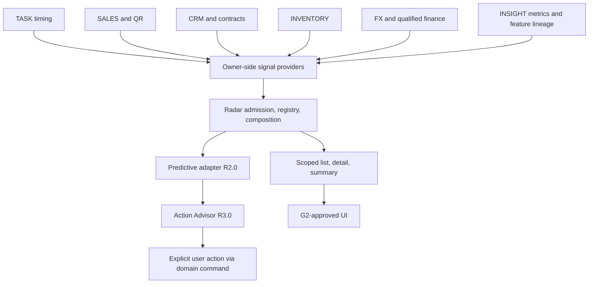

# RM-RADAR-VISION-R1 — Intelligent Business Control Center
## Стратегическое техническое задание R1.1 — Analytics First

**Дата:** 2026-11-25. **Репозиторий:** alimbetov/RM. **Ветка:** base_dev. **Source review:** 4e55c82c653efc761bb7f381cb87d5a7ff9f7058.  
**Идентификатор:** IDEA-18, связь с IDEA-16/KF-03.  
**Статус:** SPEC_EXISTS / DOC-ONLY / POST-MVP PARKED / IMPLEMENTATION NOT AUTHORIZED / PRODUCTION HOLD.  
**Решение владельца:** сформировать отдельное ТЗ развития Radar и зарегистрировать его в банке идей. Не является снятием freeze, допуском к реализации или утверждением конкретных будущих SLA.

## 0. Owner roadmap decision — Analytics First (2026-11-25)

Владелец предложил отложить доработку Radar до развития аналитической базы: Radar должен получать достоверные показатели и исторические факты, а не создавать конкурирующий расчётный контур. **IDEA-18: DEFERRED / ANALYTICS_FIRST / POST-MVP PARKED.** Пауза плановых расширений и самостоятельной оптимизации Radar; существующий R0.1 сохраняется в коде, обязательные regression/security gates, минимальные исправления реальных блокеров и R0.1D acceptance requirements не отменяются. Незакрытую квалификацию не считать PASS; до отдельного возобновления не назначать Radar новым продуктовым приоритетом. R0.2 и все R1+ этапы остаются PARKED. Это решение не разрешает реализацию аналитики вопреки MVP freeze.

Порядок после соответствующего scope admission:
1. RM-INSIGHT-R1: owner-owned достоверные SALES/INVENTORY facts, immutable history, source admission, reconciliation, replay/rebuild, tenant-safe read contracts, фактическая нагрузочная квалификация.
2. RM-INSIGHT-FIN-ADAPT-R1 / IDEA-17: Metric Registry, Period Resolver, Native SQL, lineage/versioning; затем обоснованные L1 daily / L2 period projections, Customer 360, Warehouse 360, KPI; не переносить FIN runtime.
3. ABC/Pareto/XYZ и аналитические признаки по мере достаточности истории; отсутствие фактов/denominator/COGS = UNKNOWN/NOT_MEASURABLE. ML не обязателен для первых deterministic signals.
4. Возобновить Radar отдельным owner decision после проверки источников соответствующей вертикали; закрыть R0.1D и актуальную регрессию до нового функционала. Начать с минимального Sales provider поверх уже квалифицированных метрик/фактов, не строить универсальный движок заранее.
5. Customer/Inventory/FX/Financial providers допускаются по мере готовности своих источников, Predictive/Advisor только после качественной истории, квалификации features и пилота.

Proposed resume gate (не утверждение новых SLA): A1 — canonical source/permission and metric definitions versioned; A2 — independent SQL oracle + ledger reconciliation, returns/cancellations and missingness; A3 — tenant-safe period, currency/unit, freshness/asOf and provenance; A4 — reproducible projection rebuild and failure behavior if projections used; A5 — documented PG load and owner command regression within approved bounds (no relaxation of current Radar 200ms/10%); A6 — one user-validated actionable use case and explicit scope authorization. Gate applies per vertical, not a requirement to finish all analytics or ML before any signal. No fake readiness from documentation. Main/production unchanged.

## 1. Продуктовая цель и scope

RM Radar развивается из оперативного контроля сроков TASK в единый центр действий продавца и руководителя: **что требует внимания, почему, каков подтверждённый бизнес-эффект, что можно сделать сейчас**. Не отдельный продукт и не третий обязательный MVP journey. Первичные аудитории: продавец, менеджер заказов, кладовщик, руководитель SMB, финансово уполномоченный сотрудник. Покупатель видит только собственные разрешённые коммерческие факты в каноническом контуре; общий Radar не становится публичной QR-страницей.

Ценность: меньше пропущенных заказов и обязательств, более раннее обнаружение дефицита и валютных отклонений, сокращение времени поиска причины и принятия решения. Любая заявка на экономию/выручку проверяется пилотом, не объявляется гарантией прибыли. Не оценивать работников автоматически по одному дедлайну; учитывать объём, сложность, изменение сроков, качество данных. Не вводить скрытый рейтинг сотрудников, автоматические санкции или surveillance.

Нормативные связи:
- [Platform Standard R2](../architecture/RM-PLATFORM-STANDARD-R2.md), [MVP Freeze](../strategy/RM-MVP-CLOSURE-FREEZE-R1.md), [Product Strategy](../strategy/RM-PRODUCT-STRATEGY-R2-SMB-QR.md).
- [Task Radar R0.1](RM-KF-RADAR-R0.1-OVERDUE-TASK-SIGNAL-R1.md), [Timing Contract](RM-KF-RADAR-TASK-TIMING-CONTRACT-R1.md), [Smart Deadline R0.2](RM-KF-RADAR-R0.2-SMART-DEADLINE-REMINDER-TEXT-R1.md).
- [INSIGHT-R1](RM-INSIGHT-R1-OPERATIONAL-ANALYTICS-PERFORMANCE.md), [FIN adaptation](RM-INSIGHT-FIN-ADAPT-R1-CRM-ANALYTICS-COMPUTATION.md), [Smart FX Shield](RM-CUR-R2C-SMART-FX-SHIELD-CONTROLLED-AUTO-PRICING-R1.md), [TASK durable outbox foundation](RM-TASK-01B-R3.2B-SLA-POLICY-DURABLE-OUTBOX-FOUNDATION.md).
- [Earlier killer features](RM-COMPETE-R1-POST-STABILIZATION-KILLER-FEATURES.md), [Idea Bank](../ideas/RM-IDEA-BANK-R1.md).
При конфликте действует более строгий существующий норматив. Никакого молчаливого переопределения state machine, коммерческого акцепта, прав, валютной политики или допуска.

## 2. Исходное состояние и граница доказательств

Source inventory подтверждает наличие классов, но не их release qualification. TASK: TaskOverdueQueryService, TaskTimingQueryService, TaskCalendarQueryService, единая история/классификация; R0.1D и performance gate требуют актуальной exact-SHA проверки. R0.2 — отдельное ТЗ, не реализован этим документом. SALES: SalesOrderQueryService, SalesPriceProposalService, SalesPickupHandoverService, сервисы возврата. CRM: CrmCustomerService, CrmInteractionService, CrmContractService, ContractExpiryPolicy. INVENTORY: StockBalanceQueryService, InventoryReservationService, InventoryHistoryQueryService, InventoryStocktakeService. FX: FxRateSnapshotService, SkuFxSellerApprovalService, существующие предшественники FX_AUTO; наличие классов не подтверждает unattended repricing. INSIGHT/FIN patterns, Tribuo и EVT — зависимые направления, не считать готовыми. Наличие finance package не доказывает полноту платежного ledger, COGS, AR/AP, кассовых данных. Перед реализацией каждого provider — source inventory exact SHA, карта фактов/permission/state и доказательство полноты.

## 3. Roadmap и границы релизов

| Этап | Результат | Приоритет | Ценность / сложность (1–10, гипотеза) | Входной gate |
|---|---|---|---|---|
| R0.1 | Сохранить Task Radar; незакрытая квалификация при возобновлении, 60 RAD/CAL семейств | HOLD / обязательная регрессия | существующий scope | R0.1D, текущие CI, 200ms/10%; без waiver |
| R0.2 | Smart Deadline Text, локали, countdown без новых business writes | P1 | 8/2 | отдельный scope, R0.1D; G2 для UI |
| R1.0 | Universal Business Signal Engine (минимальный контракт + композиция) | после INSIGHT | 9/4 | Analytics First A1–A6 для первого provider; R0.1D; post-MVP scope decision; G1/domain review |
| R1.1 | Sales Radar | P1 | 10/4 | qualified SALES/QR + signal foundation |
| R1.2 | Customer & Contract Radar | P1 | 9/5 | CRM scope, consent, analytics quality |
| R1.3 | Inventory Radar | P2 | 9/5 | INVENTORY + Warehouse 360; прогноз отдельно |
| R1.4 | Financial & FX Radar | P2 | 10/6 | qualified financial facts, currency rules, FX lineage |
| R2.0 | Predictive Radar | P3 | 9/8 | INSIGHT facts, feature/model quality & pilot |
| R3.0 | Action Advisor | P3 | 10/8 | reliable signals, recommendation acceptance |
Нумерация относится к **RM-RADAR-VISION**, не переименовывает исторические KF-03 milestones. CRM contract-expiration (бывший KF R0.2) входит в будущий R1.2 только после отдельного допуска. R0.2-SMART-DEADLINE остаётся самостоятельным контрактом. R1.0 не создаётся «на вырост»: сначала минимальный Task adapter + один end-to-end Sales signal. Нет обязательных микросервисов, Redis/Kafka, LLM или ML для R1.0.

## 4. Каталог детерминированных сигналов

Все пороги ниже — примеры для product discovery; часы/дни, бизнес-календарь, severity, currency/amount limits и policy version утверждаются по tenant/use case. Нет скрытого универсального значения. Отсутствие данных/прав/политики не трактуется как отсутствие риска. Каждая строка имеет будущий owner-side qualified read contract.

| ID / signal | Триггер и обязательные факты | Действие и ограничения |
|---|---|---|
| T01 TASK_OVERDUE | Авторитетный R0.1 overdue | Открыть доступную задачу; не пересчитывать |
| T02 TASK_DUE_SOON | R0.1 <=24h | Планировать исполнение |
| T03 TASK_TIMELINESS / ORIGINAL_LATE | R0.1 immutable event evidence, effective/original | Анализ выполнения, не employee score |
| S01 ORDER_PENDING_CONFIRMATION | Допустимый PLACED, owner timestamp, возраст выше policy | Проверить/подтвердить через SALES; не резервировать автоматически |
| S02 QUOTE_AWAITING_RESPONSE | Живое предложение, текущий version/state, actor side, response deadline/age | Открыть торг; исключить withdrawn/expired/accepted по owner semantics |
| S03 PICKUP_DELAY | READY_FOR_PICKUP и доказанное время перехода, policy | Связаться с клиентом; не раскрывать pickup secret |
| S04 FULFILLMENT_STALLED | Каноническая стадия комплектации/выдачи и последний переход | Проверить склад; не менять статус |
| S05 RETURN_PENDING | Допустимый незавершённый return stage и история | Открыть возврат; не делать stock posting/refund |
| C01 CONTRACT_EXPIRING | Активный договор, срок и ContractExpiryPolicy | Проверить продление; не изменять договор |
| C02 FOLLOWUP_GAP | Последнее разрешённое взаимодействие, период наблюдения | Запланировать контакт; не отправлять сообщение автоматически |
| C03 CUSTOMER_ACTIVITY_DROP | Customer 360, сопоставимые периоды, достаточная история, seasonality | Обсудить восстановление активности; не считать отсутствие заказов churn |
| C04 REPEAT_PURCHASE_OPPORTUNITY | Подтверждённая история покупок и окно повторения | Предложить контакт при наличии полномочий/consent |
| I01 LOW_AVAILABLE_STOCK | Канонический available quantity, SKU+warehouse, единицы, policy | Проверить закупку; не создавать резерв |
| I02 LONG_LIVED_RESERVATION | Активный reservation, возраст и связанный заказ | Проверить необходимость; не освобождать самовольно |
| I03 STOCKTAKE_DISCREPANCY | Qualified stocktake evidence, единицы/warehouse | Рассмотреть расхождение; не корректировать stock |
| I04 EXCESS_OR_SLOW_STOCK | Warehouse 360, valid period turnover, inventory policy | Рассмотреть ассортимент; не объявлять forecast фактом |
| F01 RECEIVABLE_DUE / OVERDUE | Только qualified invoice/payment/allocation/credit-note ledger, outstanding и due | Проверить задолженность; заказ ≠ долг |
| F02 MARGIN_RISK | Подтверждённые net revenue, cost, tax/discount/return treatment и currency | Проверить маржу; без COGS — UNKNOWN, не фиктивная прибыль |
| F03 FX_EXPOSURE | Авторитетный approved anchor, rate revision/nominal, currency, age | Открыть FX preview; не переоценивать согласованные заказы |
| F04 FX_POLICY_HOLD | Canonical FX policy/preparation denial or stale source | Показать причину/hold; не обходить guardrails |
| F05 CASHFLOW_GAP | Только подтверждённые обязательства/поступления и методика cashflow | Сценарный анализ, не прогноз остатка без данных |

Финансовые величины: BigDecimal, canonical currency + precision/rounding policy, rate source/date/revision и nominal, gross/net distinction. Не складывать USD, KZT и другие валюты без явной конверсии, не дублировать FX pricing calculator. Исторические accepted prices неизменяемы. Сигнал «сумма заказов под риском» не равен ожидаемому убытку или дебиторской задолженности. До подтверждения источника F01/F02/F05 = BLOCKED_DEPENDENCY, а не нулевое значение. Персональные/контактные данные только в защищённом detail владельца, не в универсальном payload.

## 5. Архитектура R1.0: предлагаемое разделение ответственности

Modular monolith Spring Boot/PostgreSQL first. Radar — read composition/orchestration; owner computes business predicate in SQL/read contract; no direct cross-domain arbitrary joins from Radar, no duplicate calculation engine. INSIGHT owns metrics/aggregation/lineage, uses FIN-adapted patterns without runtime dependency on FIN. EVT owns notifications/consent/delivery; Radar does not implement second outbox or scheduler. FX owns repricing and consent; Radar never calls AUTO as side effect. TASK R0.1 remains stable; adapter preserves original DTO/behavior. Schema/index/projector changes require separate ADR/CR and evidence. No new REST/UI until G2; no new public scope.

Proposed internal interfaces (not existing classes or binding API):
- SignalTypeRegistry: closed type, owner, evidence contract version, policy schema, required read admission, sensitivity, reason codes, action kinds, availability status. Reject unknown type/policy; no arbitrary expression/SQL by tenant.
- DomainSignalProvider: query admitted scoped eligible signals, filtered and ordered before LIMIT; bounded batch, detail revalidation. Every provider independently checks current verified identity and tenant/domain permissions using canonical transaction fence. No actor minted by Radar.
- RadarCompositionService: validates normalized filter, orchestrates bounded provider reads, merges deterministic order, reports per-provider freshness/availability. No N+1 lookups per card, no global count inferred from partial lists.
- RadarSignalSnapshot: stable scoped signal key, type, owner domain, opaque subject reference, sourceVersion/evidence refs (non-secret), policyVersion, evaluatedAt/asOf, event/due time, severity, priority reason, evidence quality, typed measures (optional currency/unit), titleCode, allowed action codes, freshness. No raw JWT, credentials, contact data, free text, pickup tokens or internal SQL. Separate detail contract reauthorizes, returns owner-safe fields.
- Policy registry: default OFF for new types, explicit tenant policy approval/version, finite bounds and expiry. Policy revisions immutable/auditable; no change of source transaction or TASK lifecycle. R0.1 existing constants unchanged.

## 6. Signal identity, ordering, lifecycle, completeness

Identity derived from (tenant, type, canonical owner subject, optional occurrence key); stable across refresh, distinct across tenants/instances; version of evidence separate. Deduplicate same identity before limit. Do not collapse distinct risks merely because same order/customer; link related signals in UI, never double-count monetary exposure without explicit disjointness. No persisted acknowledge/snooze state in first read-only slice. Proposed later lifecycle OPEN/RESOLVED/UNKNOWN plus per-user ACK/SNOOZE metadata only after separate admission; ACK does not resolve underlying risk, snooze expires and critical bypass requires approved policy. Changes to source state drive resolution; source outage = UNAVAILABLE/STALE, not RESOLVED.

Stable global order proposed severityRank DESC, policy priorityBand DESC, relevantAt ASC NULLS LAST, owner/type/subject stable key ASC. No unapproved cross-domain conversion of amounts into severity. Deterministic comparator and total ordering, versioned ordering policy. Filters: domains, types, severity, perspective, date basis/range, state, data-quality/freshness; AND across categories, OR inside set; no unauthorized types exposed. Per-provider keyset and merge of top K from each eligible provider only when common comparator and membership predicates are equivalent; otherwise use owner-qualified indexed composition projection with separate admission. Bound fan-out and page size <=100, limit+1 semantics; cursor bound to tenant, actor, canonical filters, provider set, order/policy version and last keys; typed opaque transport only later G2. Fresh authorization every page, no cached grant. Reject cursor on changed policy/provider set, no leaking denied provider counts. Live pages, no global frozen snapshot guarantee. Same-statement consistency within domain; multiple transactions/provider watermarks disclosed; do not claim single cross-domain snapshot or compare rowVersion across subjects. If snapshot required, separate contract.

Error policy: authorization failure for requested resource = deny; authorized provider unavailable = explicit partial status and freshness; do not represent as successful empty result. Empty complete result only when all authorized selected providers evaluated successfully. Do not permit stale detail/action. Timeout/cancellation bounded, no unbounded retries, no background work by default. If projector later admitted: composite tenant keys, idempotent event handling, ordered per-aggregate source versions, dedup, replay/rebuild, reconciliation, retention and failure DLQ defined before release; derived projection never canonical business source; durable outbox remains owner-managed. No lost/duplicate effect on crash.

## 7. Security, privacy, audit

VerifiedActor from trusted access token; current TASK_READ/SALES/CRM/INVENTORY/FX/financial owner rights verified from actual domain contracts, not fabricated permission names. IAM account/membership/workspace active and tenant scoped at admission; no implicit admin/owner wildcard. Candidate new RADAR permissions only via separate IAM ADR; Radar grant is insufficient for owner access. No mixed-tenant cache, aggregate count, cursor, export, logs, predictive features or explanation. Security fencing for revoke/suspend both commit orders; expiry during long read denies result. Audit policy, recommendation version, consent, explicit action outcome; mask secrets/PII, log reason codes and bounded correlation IDs. Read-only request does not create domain business events or modify ledger. Tenant-specific event processing uses least-privilege separately admitted service identity; no impersonation. External notification requires EVT/consent, explicit destination policy and opt-out. Retention/deletion and backup/rebuild tests needed if future persistence added.

## 8. User journeys and presentation contract (design only)

Seller morning agenda: urgent order pending, due task, pickup delay → open relevant authorized order → explicit canonical action → refresh and resolution. Warehouse: low available stock and long reservation → inspect warehouse/stock ledger → approved domain action. Owner: overview by authorized scope; not all tenant data by default. Finance user: FX risk/unknown margin → preview with rate evidence → separately approved FX flow. Manager: effective on-time and original late shown together; no misrepresenting shifted deadlines.

Home: critical/attention/information sections, scoped domain tabs, filtered list/calendar where valid date basis, reason and as-of, clear stale/partial indicators, accessible colors + labels, drilldown into owner record. No misleading counters from page length; aggregates separately qualified. RU/KK/EN initially aligned with R0.2, translation keys not business predicates; exact timestamps localized with IANA zone. No external calendar sync. Acknowledge and snooze UI marked future, not current. No REST/UI implementation by this document.

## 9. Predictive Radar R2.0 and Action Advisor R3.0

Start with deterministic rules. Predictive use cases: overdue probability at approved horizon, stockout risk by SKU/warehouse/horizon, customer repeat purchase/churn proxy, possible order abandonment. No inference where outcome labels not defined, sparse/censored data, concept drift or missing feature lineage. INSIGHT Feature Registry versioned source, event-time/as-of joins (no future leakage), temporal train/validation/test split, tenant isolation and consent, reproducible feature snapshot, model artifact SHA, modelVersion, training window, calibrated probability + uncertainty, baseline comparison, reason codes and model card. Tribuo is candidate implementation, not mandatory dependency today. No cross-tenant training without separate lawful/approved governance. ML never overwrites facts, threshold or immutable transactions. Shadow mode then controlled pilot; drift, precision/recall, calibration, abstention, false positive/negative cost, version rollback; no guarantee from model score. If model unavailable fallback to rule signals, prediction UNKNOWN. Proposed model metrics must be agreed for actual outcome and horizon before training.

Advisor initial rule-based playbooks: action codes with rationale, source evidence, expected impact range only if supported, prerequisite permissions, expiry, alternatives. Recommendation is NOT a command, no automatic order confirmation, reserve release, price change, task reassignment, message or return. User explicitly confirms; target owner reauthorizes, validates fresh sourceVersion/state/policy, idempotency and records result; stale action returns conflict and refresh. Multi-step action requires canonical owner orchestration/atomicity proof, no partial effects silently. Future bounded automation requires separate owner authorization, risk policy/limits, kill switch, audit and production approval. No LLM dependency required; if introduced, output schema/allowlist, untrusted text isolation, no executable tool command from model output.

## 10. Performance and operations — non-negotiable gates

R0.1 retains strict existing PostgreSQL 17/H2 gates, 137/137 baseline target (future added tests counted separately), TASK regression 53 PG/35 H2 +18 expected skips, 60 families including UI deferrals, 100k p95 <=200ms and mixed TASK p95 degradation <=10%. Actual failure is HOLD, not waive by averaging or favorable retries. Do not infer final readiness from class presence. Future Radar providers must separately demonstrate owner regression and mixed cross-domain load; proposed targets for first R1 slices: per-provider warm p95 <=200ms at documented 100k source fixtures, combined <=500ms at approved provider count and load; baseline command degradation <=10% per relevant owner workload. These are design proposals, not production SLA, and cannot replace current R0.1 thresholds. Prior to implementation approve resource budgets, query counts, concurrency caps, pool isolation if justified, timeout and load profile, freshness lag SLA for async projection if authorized. Record cold/warm cache, hardware, PG settings, data distribution, tenant skew, history size, p50/p95/p99, throughput, locks/waits, CPU, allocation/GC, EXPLAIN ANALYZE BUFFERS, raw sample counts and variability; stable predeclared repetition and genuine overlap. Never hide overload by dropping requests without measuring rejection rate. No blind full tenant scans, OFFSET, per-card query, duplicate scheduler or unbounded fan-out. No read replica assumption for current authorization or read-after-write; later consistency ADR required. Alert on provider errors/lag, unexpected empty, model drift, command degradation; correlation without sensitive payload. Recovery drills and rollback plan prior to release.

## 11. Product validation and economic evidence

Measure pilot baseline vs comparable period/cohort: median time from event to first useful action, overdue order rate, eligible signal precision, missed actionable events, time saved per operator, conversion of eligible signals to completed owner actions, original vs effective deadline compliance, inventory stockout rate on defined scope, recoverable revenue proxy (not guaranteed incremental revenue), FX policy holds and stale rate avoidance. Track alert burden, dismissals, false positives, permissions/partial coverage and sample sizes. For predictive pilot include calibration and real-world cost. No automatic causality claim from before/after alone. Define numerator, denominator, period, eligibility, attribution, currency and data source in Metric Registry; absent denominator = NOT_MEASURABLE. Proposed go/no-go pilot targets subject to explicit approval: meaningful reduction of median action time (e.g. 20%), actionable precision >=80% for selected deterministic signals, no security/invariant breach, no material command regression beyond accepted gates; exact definition/sample before pilot, not selected post hoc.

## 12. Qualification matrix — 48 future scenario families (not executed tests)

| ID | Scenario and required outcome |
|---|---|
| BV-01 | R0.1 adapter preserves authoritative classification, magnitude, original evidence |
| BV-02 | R0.2 text boundary/equality, localization, stale state; original contract retained |
| BV-03 | Owner signal registry rejects unknown types/policies and disabled signals |
| BV-04 | Same source replay/refresh yields same identity, no duplicate |
| BV-05 | Distinct occurrence/type/tenant never merged |
| BV-06 | Source resolves risk; provider unavailable never falsely resolves |
| BV-07 | Ordered top-K merge exact vs independent oracle, ties/multiple domains |
| BV-08 | Filter before LIMIT; sparse matches and bounded fan-out |
| BV-09 | Cursor scope/filter/order/policy/size mismatch denied |
| BV-10 | Live updates between pages documented; static traversal exact |
| BV-11 | Partial vs complete empty; no fabricated counts |
| BV-12 | Per-domain snapshot version coherent, no fake global commit watermark |
| BV-13 | PLACED waiting signal appears/disappears on canonical confirm/cancel |
| BV-14 | Quote response/expiry/withdraw/checkout races no stale actionable offer |
| BV-15 | Pickup/fulfillment stage evidence correct, secrets excluded |
| BV-16 | Return stages and owner state, no inventory posting/refund side effect |
| BV-17 | Contract expiry exact boundary, inactive/missing contract excluded or unknown |
| BV-18 | Follow-up gap based on authorized evidence, no automatic message |
| BV-19 | Activity decline comparable periods, sparse/seasonal data abstention |
| BV-20 | Repeat purchase suggestion uses consent and valid historical facts |
| BV-21 | Available stock by warehouse/SKU/unit, reservation counted correctly |
| BV-22 | Long reservation vs release/fulfill races no false promise |
| BV-23 | Stocktake discrepancy; no automatic stock mutation |
| BV-24 | Slow stock/turnover with returns and missing denominator |
| BV-25 | AR overdue uses allocations/credits and due evidence, order not debt |
| BV-26 | Margin with verified COGS, tax, return, discount; missing cost UNKNOWN |
| BV-27 | Currency precision/nominal/revision; mixed currency no implicit sum |
| BV-28 | FX stale source/hold; agreed order immutable, no repricing side effect |
| BV-29 | Cashflow missing data and scenario distinction |
| BV-30 | Cross tenant same IDs, no row/count/cursor/log leak |
| BV-31 | Least privilege, owner/global admin without domain grant denied |
| BV-32 | Revoke/suspend vs read both commit orders; signed access token expiry |
| BV-33 | DTO/log/audit allowlist and detail reauthorization |
| BV-34 | SQL error/timeout/cancel fail closed and fresh retry |
| BV-35 | Zero business DML, before/after owner ledgers, one bounded provider query |
| BV-36 | PG 1k/10k/100k, dense/sparse, skew/history, plans and latency |
| BV-37 | Mixed concurrent canonical commands, regression and actual overlap |
| BV-38 | Projection replay/idempotency/version gap/rebuild/crash (only if admitted) |
| BV-39 | Feature as-of and temporal split, no leakage/tenant mixing |
| BV-40 | Reproducible model/metric baseline, calibration and abstention |
| BV-41 | Drift/rollback/model unavailable fallback; rules unaffected |
| BV-42 | Advisor evidence, allowed action and stale version rejection |
| BV-43 | Confirmed action uses owner authorization/idempotency/atomicity |
| BV-44 | No auto-action from signal/ML/LLM, audit and consent |
| BV-45 | EVT consent/dedup/expiry and failure handling (only if admitted) |
| BV-46 | UI filters/partial pages/accessibility/timezone/expiry (G2) |
| BV-47 | Product metric denominator/attribution/unknown and pilot UAT |
| BV-48 | Exact-SHA manifest, all owner regressions, rollback and release admission |

Trace matrix per approved slice maps applicable BV subcases to concrete methods, engines, XML, plans, independent oracles and evidence SHA; conditional futures marked DEFERRED with reason, never PASS. Real signed JWT and PostgreSQL transaction qualification, H2 only compatibility, no test-only production mint or skipped required jobs. No double counting inherited RAD/CAL/BSR tests. Keep existing mandatory gates unchanged.

## 13. Delivery and approval

V0: this document + IDEA-18 only. Analytics First §0 supersedes the immediate Radar development sequence. Preserve mandatory regression and security gates; R0.1D must be qualified before new Radar feature admission, not asserted complete during pause. No global release bypass. Each future stage V1+ requires explicit owner scope, relevant MVP G3/post-MVP rule or explicit authorized exception, actual domain inventory, acceptance tests and cost/benefit decision. R1.0 foundation and R1.1 pilot should be reviewed together to avoid unused abstraction; other providers opt-in. G2 REST/UI separately authorized; G3 controlled pilot, G4 production release separate. Status scale SPECIFIED → IMPLEMENTED → SERVICE TESTED → PG QUALIFIED → USER ACCEPTED → RELEASE ADMITTED; no forward promotion solely by document. Global production remains HOLD, base_dev only, main unchanged. Do not extend current TASK R0.1 backlog with any BV future features.

## 14. Open decisions before coding

D-V01: exact active status/age fields, permissions and source sufficiency for first Sales signals. D-V02: tenant policy thresholds/business calendar, severity/priority comparator and access to policy edits. D-V03: list/detail vs aggregate counters, live multi-provider budget/timeout, read-model choice based on profiling. D-V04: canonical financial data availability/definitions; no fictional payment/COGS data. D-V05: customer activity horizon/consent and pilot cohort. D-V06: Tribuo features/labels/model evaluation and rollback after sufficient history. D-V07: explicit automation/EVT scope and approval (default OFF). D-V08: final product metrics and production SLO per stage. These decisions are proposals, not approvals. Resolve and sign in slice-specific TЗ/ADR, do not rewrite current contracts.

## 15. Revision log

R1.0 — 2026-11-25: strategic vision and future signal catalogue, service boundaries, staged roadmap, acceptance matrix; IDEA-18 registered. No code, SQL, migrations, scheduler, API, UI, ML or production change.

R1.1 — 2026-11-25: Owner Analytics First decision; defer Radar development pending qualified INSIGHT facts/metrics by vertical and explicit resumption. Existing R0.1 code and gates preserved, no scope extension or production admission.
